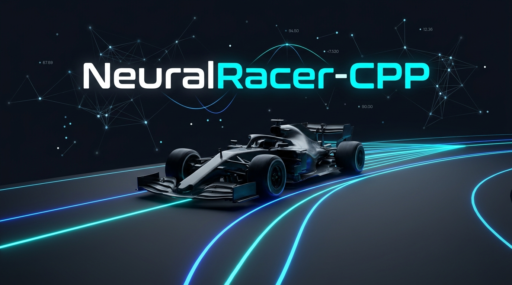
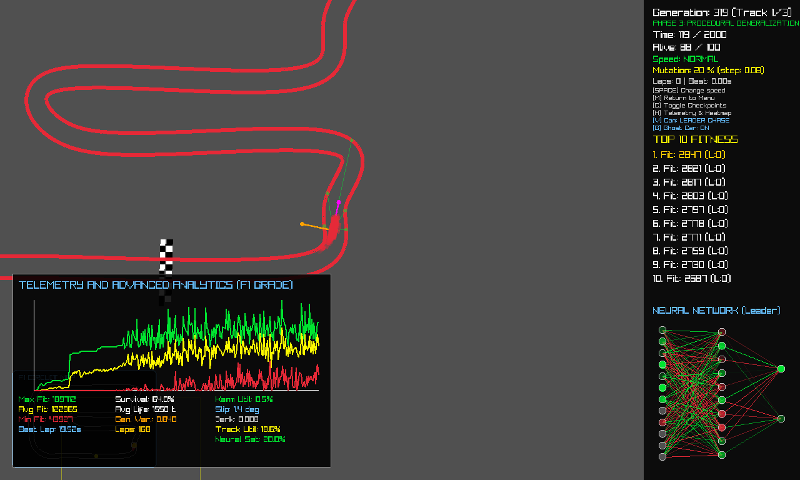
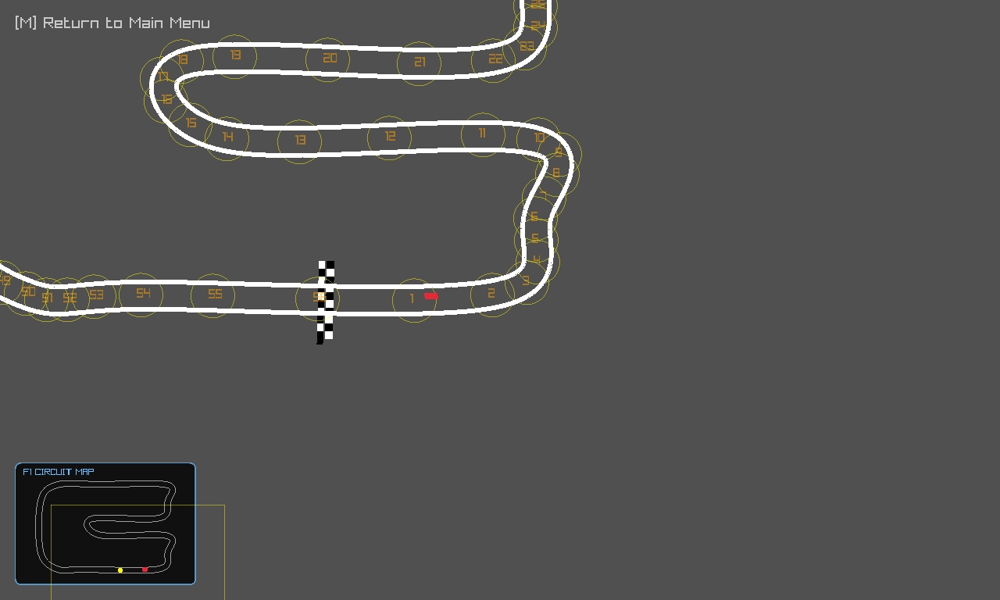
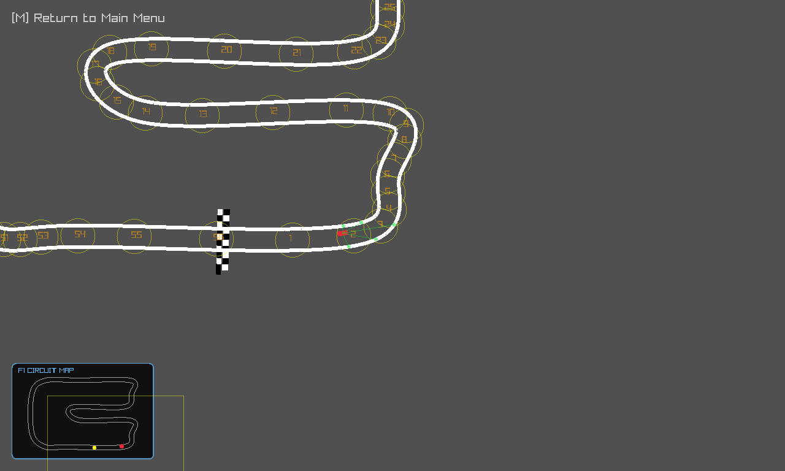
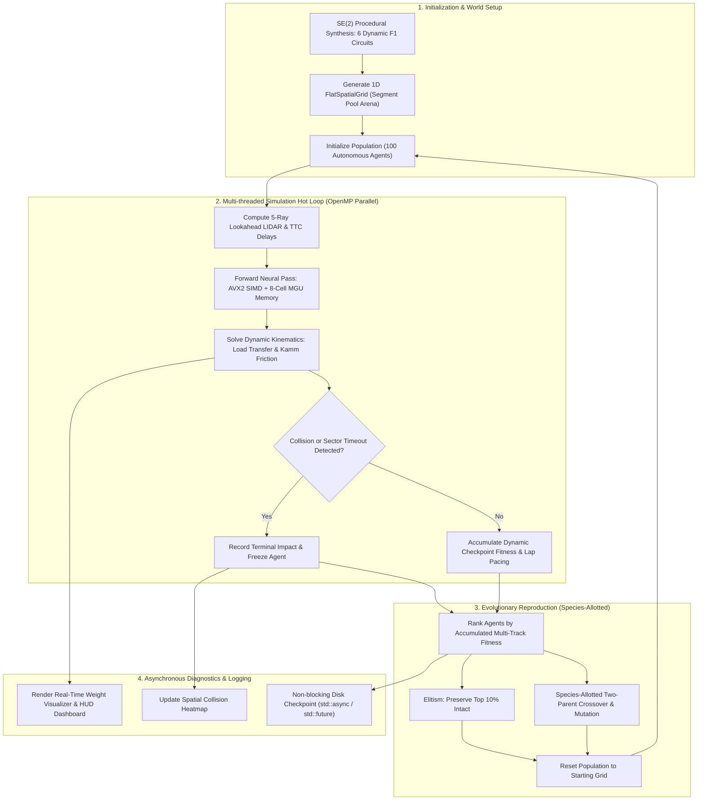

<div align="center">



# 🏎️ NeuralRacer-CPP

**A High-Performance 2D Autonomous Driving Simulation & Neuroevolution Engine in Modern C++17**

*Zero-Allocation Hot Path • AVX2 / FMA Vectorization • Recurrent MGU Neurons • Lumped Tire Thermals • Formula 1 Dynamics*

<p align="center">
  <a href="https://github.com/jorgebd21/NeuralRacer-CPP/releases/tag/v2.6.0"></a>
  <a href="https://en.cppreference.com/w/cpp/17"></a>
  <a href="https://en.wikipedia.org/wiki/Advanced_Vector_Extensions"></a>
  <a href="https://www.openmp.org/"></a>
  <a href="https://www.raylib.com/"></a>
  <a href="#-build-installation--cli-reference"></a>
  <a href="LICENSE"></a>
  <a href="CONTRIBUTING.md"></a>
</p>

<p align="center">
  <a href="#-quick-start-in-60-seconds">⚡ Quick Start</a> •
  <a href="#-table-of-contents">📑 Table of Contents</a> •
  <a href="#-core-pillars--technical-highlights">🔬 Deep Tech</a> •
  <a href="#-operational-simulation-modes">🎮 Modes & Replay</a> •
  <a href="#-system-architecture--execution-lifecycle">🏗️ Architecture</a> •
  <a href="#-keyboard-controls--runtime-hud-interactions">💻 Controls</a>
</p>

---

</div>

## ⚡ Quick Start (in 60 Seconds)

Get **NeuralRacer-CPP** compiled and running locally on Ubuntu / Debian with four simple commands:

```bash
# 1. Install dependencies
sudo apt update && sudo apt install -y build-essential cmake libraylib-dev libomp-dev libtbb-dev

# 2. Clone the repository
git clone https://github.com/jorgebd21/NeuralRacer-CPP.git && cd NeuralRacer-CPP

# 3. Build with CMake (-j2 recommended to prevent RAM starvation)
mkdir -p build && cd build && cmake .. && cmake --build . -j2

# 4. Launch interactive simulation (Raylib hardware-accelerated 2D UI)
./bin/app
```

### Simulated Startup Output:
```text
[NeuralRacer Engine] Initializing Modern C++17 Core...
[CPU Hardware] AVX2/FMA vector registers detected and engaged.
[Concurrency] OpenMP initialized across 12 logical worker threads.
[TrackManager] Synthesizing SE(2) Grand Prix Circuit (Silverstone Archetype)...
[SpatialGrid] 2400x1600 canvas partitioned into 100px cells. Segment pool arena: 0 heap allocations.
[Population] 100 autonomous agents instantiated. MGU recurrent memory online.
[Display] Raylib 2D hardware-accelerated viewport opened at 1280x800 @ 60 FPS.
>> Press [ T ] to train | [ E ] for human vs AI race | [ R ] for telemetry replay <<
```

---

## 📑 Table of Contents

- [⚡ Quick Start (in 60 Seconds)](#-quick-start-in-60-seconds)
- [✨ Autonomous Training in Action](#-autonomous-training-in-action)
- [🔬 Core Pillars & Technical Highlights](#-core-pillars--technical-highlights)
- [🎮 Operational Simulation Modes](#-operational-simulation-modes)
- [🏗️ System Architecture & Execution Lifecycle](#-system-architecture--execution-lifecycle)
- [⚡ Real-Time Zero-Allocation Hot Path](#-real-time-zero-allocation-hot-path)
- [🏎️ Deep Dive: Formula 1 Powertrain & Kinematics](#-deep-dive-formula-1-powertrain--kinematics)
- [🏁 Discrete SE(2) Procedural Track Generator](#-discrete-se2-procedural-track-generator)
- [📊 Longitudinal & High-Frequency Telemetry Suite](#-longitudinal--high-frequency-telemetry-suite)
- [💻 Keyboard Controls & Runtime HUD Interactions](#-keyboard-controls--runtime-hud-interactions)
- [🛠️ Build, Installation & CLI Reference](#-build-installation--cli-reference)
- [📐 Mathematical Formulations Reference](#-mathematical-formulations-reference)
- [📦 Directory Structure](#-directory-structure)
- [📜 Versioning & Releases](#-versioning--releases)
- [🤝 Contributing & Community](#-contributing--community)
- [⚖️ License](#-license)

---

## ✨ Autonomous Training in Action

<div align="center">


*Autonomous agents learning to navigate procedural racetracks using raw proximity raycasts and velocity vectors. The telemetry dashboard on the bottom left monitors fitness curves, while the neural topology map on the bottom right visualizes active synaptic weights in real time.*

</div>

---

## 🔬 Core Pillars & Technical Highlights

NeuralRacer-CPP is a high-performance simulation engine designed to explore autonomous driving behaviors through neuroevolutionary algorithms. The core objective of the project is to simulate realistic physical vehicle dynamics and train autonomous agents to navigate complex, procedurally generated race tracks.

To achieve maximum computational efficiency and real-time responsiveness, the entire system is built **completely from scratch** in Modern C++17 without relying on high-level machine learning frameworks or pre-existing physics engines.

### Architectural Value Matrix:

| Capability | Naive 2D Simulators | NeuralRacer-CPP Engine | Engineering Benefit |
| :--- | :--- | :--- | :--- |
| **Hot Path Memory** | Dynamic `std::vector::push_back` | **`FixedRingBuffer` & 1D Arena** | **0 heap allocations** per frame; zero garbage collection pauses. |
| **Forward Inference** | Nested `for` loops in scalar math | **AVX2 / FMA + Padé [3/3] $\tanh$** | 8-wide float SIMD vectorization; sub-microsecond latency. |
| **Chassis Dynamics** | Simplified Arcade Point-Mass | **Kamm Friction Ellipse & Thermals** | Realistic tire grip limits, weight transfer, and scrub drag. |
| **Circuit Topology** | Static Hardcoded Paths | **$SE(2)$ Tile Coupling & Macro-Graphs** | 6 Grand Prix archetypes with infinite zero-shot procedural variety. |
| **Perception Memory** | Stateless Feedforward FNN | **8-Cell Minimal Gated Unit (MGU)** | Agents anticipate turn sequences with recurrent temporal memory. |
| **Analytical Insights** | Opaque scalar fitness score | **MoTeC-Grade 60Hz XAI Telemetry** | Exact input Jacobians ($\partial\text{Steer}/\partial\text{Lidar}$) and heatmaps. |

*   **Zero-Allocation HPC Pipeline & 1D Flat Spatial Grid:** Eliminates runtime dynamic heap allocations (`0 malloc/new` calls in hot path) using preallocated contiguous `FixedRingBuffer` per vehicle and a cache-friendly 1D row-major `FlatSpatialGrid` backed by a centralized segment pool arena.
*   **SIMD AVX2 / FMA Acceleration:** Fully vectorizes neural network matrix-vector operations ($\mathbf{W}\mathbf{x} + \mathbf{b}$) and employs a high-precision [3/3] rational Padé polynomial approximation of $\tanh(x)$ for ultra-low latency forward inference.
*   **Multi-Surface Dynamics & Tire Thermodynamics:** Implements dynamic surface grip zones ($\mu$ partitioning for asphalt, FIA apex curbs, astroturf runoff, and gravel traps) integrated with a lumped-parameter tire thermal degradation model ($85^\circ\text{C}\text{--}100^\circ\text{C}$ optimal grip envelope).
*   **Multi-Agent Perception & Aerodynamic Slipstream:** Equips agents with vehicle-detecting 5-ray LIDAR sweeps and relative velocity sensing ($\Delta v$), aerodynamic slipstream wake drafting for high-speed overtakes, and momentum-conserving 2D elastic impulse collisions.
*   **Temporal Recurrent Neuroevolution (MGU) & Speciation:** Replaces purely memoryless feedforward networks with an 8-cell Minimal Gated Unit (MGU) recurrent layer for temporal corner anticipation, safeguarded by NEAT-inspired genomic compatibility clustering and fitness sharing.
*   **Telemetry Visualizer & 60Hz Replay Engine:** Features semi-transparent ghost vehicle replay from historical fastest laps, GPU-accelerated racing line heatmaps (speed, trail-braking, scrub), an interactive timeline scrubber with variable playback ($0.25\times, 1\times, 4\times$), and real-time cockpit XAI Jacobian sensitivity vectors.
*   **F1-Scale World Expansion & Dynamic 2D Camera:** Expands the simulation canvas to an expansive $2400 \times 1600\text{ px}$ arena ($6.4\times$ track area) supporting genuine Grand Prix aspect ratios (up to 3.5:1) and $600\text{--}900\text{ px}$ DRS straights. Decoupled world rendering features a Raylib `Camera2D` dynamic chase drone with spring-damper tracking (`CAM_FOLLOW_LEADER`), adaptive full-track overview (`CAM_OVERVIEW`), smooth mouse-wheel zooming, and a real-time tactical F1 Minimap HUD.
*   **Hardware Concurrency:** Exploits multi-core architectures by parallelizing the physics engine and neural network evaluations using native **OpenMP** multi-threading and C++17 vectorization across all CPU cores.
*   **Asynchronous Subsystems:** Implements non-blocking disk serialization (`std::async`/`std::future`) to isolate high-frequency hot paths from storage delays during generational checkpoints.

---

## 🎮 Operational Simulation Modes

The engine provides four distinct simulation configurations to analyze agent behaviors, compete head-to-head, and interactively scrub telemetry:

| **1. Training Mode** | **2. Exhibition Mode** | **3. Test AI Mode** | **4. Replay Mode** |
| :---: | :---: | :---: | :---: |
| [](docs/Training.png) | [](docs/Exhibition.png) | [](docs/TestAI.png) | `[ R ] Key` |
| *Neural network undergoing continuous training with live dashboard metrics and weight visualizations.* | *Manual player driving (blue car) competing head-to-head against the elite neural network brain (red car).* | *Observing the standalone driving strategy of the saved elite network navigate challenging curves.* | *Interactive 60Hz telemetry scrubber with ghost car projection, speed heatmaps, and cockpit Jacobians.* |

---

## 🏗️ System Architecture & Execution Lifecycle

The following diagram illustrates the execution lifecycle, data pipelines, and concurrency models utilized by the simulator:



---

## ⚡ Real-Time Zero-Allocation Hot Path

To guarantee rock-solid 60 FPS pacing without garbage collection latency, every frame's calculations stream through a deterministic, zero-allocation dataflow pipeline:

```mermaid
flowchart LR
    subgraph Sensors ["1. Perception Horizon"]
        S1["Lookahead LIDAR<br/>(±75°, ±20°, 0°)"]
        S2["Dynamic TTC<br/>Closing Delta"]
        S3["Competitor OBB<br/>Spatial Queries"]
    end

    subgraph NeuralCore ["2. SIMD & Recurrent Core"]
        N1["AVX2 Matrix Kernel<br/>(W·x + b)"]
        N2["Padé [3/3] Rational<br/>(Ultra-Fast tanh)"]
        N3["8-Cell MGU Memory<br/>(Temporal Retention)"]
    end

    subgraph ChassisPhysics ["3. Formula 1 Dynamics"]
        P1["F1 Powertrain<br/>(68N Thrust / 210N Brake)"]
        P2["Kamm Adhesion<br/>(Friction Ellipse)"]
        P3["Tire Thermals<br/>(85°C–100°C Window)"]
    end

    subgraph CollisionEngine ["4. Zero-Alloc Narrow Phase"]
        C1["1D FlatSpatialGrid<br/>(Segment Pool Arena)"]
        C2["FixedRingBuffer<br/>(0 Malloc Telemetry)"]
    end

    Sensors --> NeuralCore
    NeuralCore --> ChassisPhysics
    ChassisPhysics --> CollisionEngine
```



---

## 🏎️ Deep Dive: Formula 1 Powertrain & Kinematics

The vehicle kinematics engine bypasses simplified movement models in favor of real-world Formula 1 race physics:

| Parameter | Value | Engineering Function | Physical Consequence |
| :--- | :---: | :--- | :--- |
| **`ENGINE_POWER`** | `68.0 N` | Forward longitudinal propulsion ($a_{\text{launch}} \approx 3.24\text{ m/s}^2$) | Accelerates from 0 to 100 km/h in $< 2.1\text{ s}$; top speed $\approx 257\text{ km/h}$. |
| **`BRAKING_POWER`** | `210.0 N` | High-G carbon-ceramic dissipation ($-10.0\text{ m/s}^2$) | Establishes a 3.1:1 brake-to-engine ratio for authentic threshold braking into hairpins. |
| **`DRAG_MULTIPLIER`** | `0.44` | Quadratic air resistance ($F_{\text{drag}} = -C_d v |v|$) | Enforces aerodynamic stabilization and realistic coasting deceleration at high speeds. |
| **`TIRE_GRIP_LIMIT`** | `0.62` | Lateral adhesion coefficient ($a_{y,\max} \approx 6.08\text{ m/s}^2$) | Unlocks high apex cornering speeds above $4.0\text{ px/t}$ without understeer slide. |
| **`FRONT_SENSOR_DIST`** | `500.0 px` | Long-range forward sightline ($> 70\text{ meters}$) | Enables decisive high-speed corner anticipation and brake point timing. |

*   **Speed-Dependent Ackermann Steering & Angular Yaw Inertia:** Yaw rate is kinematically scaled to forward speed with low-pass angular inertia filtering ($\omega_t = 0.65\,\omega_{t-1} + 0.35\,\omega_{\text{target}}$). This physically grounds steering response, prevents zero-speed spinning, and completely eliminates unphysical 1-tick bang-bang steering oscillation exploits.
*   **Friction Circle & Kamm Traction Budgeting:** Evaluates restoring cornering grip against a physical adhesion limit ($F_{\text{max\_grip}} = \mu_{\text{tire}} \cdot M$) and couples lateral grip demand to longitudinal engine traction ($F_{x,\max} = \sqrt{\max(0, F_{\text{grip}}^2 - F_y^2)}$). Applying high lateral cornering demand restricts available forward acceleration.
*   **Realistic Induced Scrub Drag & Coulomb Rolling Resistance:** Implements constant rolling friction ($F_{\text{roll}} = -\mu_{\text{roll}} \cdot \text{sgn}(v)$) and amplified lateral scrub resistance ($K_{\text{scrub}} = 55.0$) plus steering deflection drag ($K_{\text{steer}} = 0.08$). Any lateral weaving or zig-zagging on straightaways incurs an immediate $\approx 28\%$ speed penalty, making straight-line driving strictly optimal.
*   **Dynamic Weight Transfer:** Acceleration shifts normal forces rearward, reducing steering capacity (understeer); braking transfers load forward, sharpening steering response.

---

## 🏁 Discrete SE(2) Procedural Track Generator

To prevent neural controllers from memorizing fixed geometric lines, the procedural generator synthesizes authentic, flowing racing circuits assembled from **17 pre-validated geometric primitives** across **6 canonical Grand Prix archetypes**:

```
Archetype 0: Monza Corridor       ─── Parallel DRS Straights, Variante Ascari, Parabolica
Archetype 1: Silverstone Flow    ─── Maggotts-Becketts Esses, Infield Loops, Stowe Corner
Archetype 2: Spa-Ardennes        ─── Kemmel Blast Straight, Pouhon Sweeper, Bus-Stop Chicane
Archetype 3: Suzuka Technical    ─── First-Sector Linked S-Curves, 130R Arc, Casio Triangle
Archetype 4: Interlagos Bowl     ─── Senna-S Deceleration, Amphitheater Horseshoe, Junção
Archetype 5: Baku Street Complex ─── High-Speed Boulevards & 90-Degree Threshold Braking
```

*   **FIA Proportional Scale:** Calibrated track width to $35\text{ px}$ and vehicle dimensions to $17 \times 8\text{ px}$ (preserving the authentic $23\%$ car-to-track ratio) unlocking multi-lane racing lines and dynamic overtaking maneuvers.
*   **$C^1$ Hermite Elastic Bridge & SAT Clearance:** Solves periodic loop closure with adaptive heading tolerance ($\pm 50.4^\circ$) and spatial clearance filtering, achieving guaranteed non-intersecting geometries in sub-millisecond execution ($<0.5\text{ ms}$).

---

## 📊 Longitudinal & High-Frequency Telemetry Suite

To support empirical machine learning research and automotive control analysis, the engine implements a dual-tier MoTeC i2-grade telemetry pipeline:

### A. Generational Convergence Analytics (`data/telemetry_log.csv`)
Records 20 synchronized macro metrics every generation:
* **Convergence & Diversity:** `Generation`, `MaxFitness`, `AvgFitness`, `SurvivalRate`, `WeightVariance`, `ActiveMutationRate`.
* **Generalization Metrics:** `CurriculumPhase` (1, 2, or 3), `BenchmarkFitness` (fixed control track score), `ProceduralFitness` (zero-shot transfer performance).
* **Kinematics & Dynamics:** `TopSpeedAvg`, `BestLapTime`, `KammUtilAvg`, `SlipAngleAvg`, `ControlJerkAvg`, `TrackWidthUtil`.

### B. High-Frequency Time-Series Dataset (`data/telemetry_best_lap.csv`)
Records full-rate (60 Hz / tick-by-tick) physical and neurocognitive metrics for the fastest lap:
* **Kinematics:** `tick`, `lap_tick`, `distance`, `x`, `y`, `speed`, `v_long`, `v_lat`, `angular_vel`.
* **Vehicle Dynamics:** `long_accel`, `lat_accel`, `kamm_util`, `slip_angle`, `jerk_long`, `jerk_lat`.
* **Actuation & Explainable AI (XAI):** `throttle_input`, `steer_input`, alongside analytical Jacobian sensitivities:
  * $\partial \text{Steer} / \partial \text{Lidar}_{\text{Front}}$ (`sens_steer_front`)
  * $\partial \text{Steer} / \partial (\text{Lidar}_{\text{Left}} - \text{Lidar}_{\text{Right}})$ (`sens_steer_lat`)

<details>
<summary><b>🔍 Click to view 45-Parameter Exhaustive Telemetry Specification (`ExhaustiveTelemetry`)</b></summary>

The exhaustive telemetry subsystem logs 45 synchronized fields every tick:
1. `tick`, `lap_number`, `sector_index`, `track_progress_ratio`
2. `pos_x`, `pos_y`, `heading_angle`, `linear_speed`
3. `v_long`, `v_lat`, `accel_long`, `accel_lat`, `yaw_rate`
4. `throttle_input`, `steer_input`, `brake_input`, `steer_slew_rate`
5. `kamm_utilization`, `tire_bulk_temp`, `tire_surface_temp`, `thermal_grip_factor`
6. `surface_type`, `surface_friction_mu`, `normal_force_front`, `normal_force_rear`
7. `lidar_0` through `lidar_4` (5-ray lookahead array), `front_ttc_delta`
8. `competitor_dist_min`, `competitor_rel_v`, `slipstream_wake_factor`
9. `sens_steer_front`, `sens_steer_lateral`, `mgu_gate_activation`
10. `coherence_steer_flag`, `coherence_throttle_flag`, `coherence_grip_flag`

</details>

---

## 💻 Keyboard Controls & Runtime HUD Interactions

### Main Execution Modes:
| Mode | Key | Functionality |
| :--- | :---: | :--- |
| **Training Mode** | `[ T ]` | Spawns 100 agents to undergo continuous evolutionary training with real-time HUD metrics. |
| **Exhibition Mode** | `[ E ]` | Manual player driving (WASD/Arrows) competing head-to-head against the elite saved AI brain. |
| **Test AI Mode** | `[ A ]` | Renders the uninterrupted standalone driving strategy of the saved elite network (`data/best.json`). |
| **Replay Mode** | `[ R ]` | Interactive 60Hz replay timeline scrubber with variable playback and real-time XAI Jacobian vectors. |
| **Generate Track**| `[ P ]` | Instantly generates a unique closed racing circuit using the discrete modular tile engine. |
| **Save Track**    | `[ G ]` | Exports the active procedural track from the menu state to a JSON file in `data/tracks/`. |

### Runtime Visualizer & Camera Shortcuts:
*   `[ SPACE ]`: In Training mode: toggles execution speed between **Normal (1x)** and **Accelerated (50x)**. In Replay mode: toggles playback **Pause / Resume**.
*   `[ G ]`: Toggles the semi-transparent **Ghost Vehicle** projection representing the recorded fastest lap.
*   `[ H ]`: Toggles the **Telemetry Dashboard**, Collision Heatmap, and GPU-accelerated **Racing Line Heatmap** (Green: traction/speed, Amber: trail braking, Red: scrub/slip).
*   `[ V ]`: Toggles camera view mode between dynamic leader-follow mode (`CAM_FOLLOW_LEADER`) and full-circuit overview mode (`CAM_OVERVIEW`).
*   `[ 1 ] / [ 2 ] / [ 3 ]`: In Replay mode: selects playback rate between **0.25x (Slow-Motion)**, **1.0x (Real-Time)**, and **4.0x (High-Speed Scrubbing)**.
*   `[ LEFT ] / [ RIGHT ]`: In Replay mode: step backward or forward frame-by-frame.
*   `Mouse Timeline Dragging`: Click and drag the golden timeline scrubber thumb at the bottom HUD to seek anywhere across the recorded lap.
*   `Live XAI Jacobian Sensitivity HUD`: Rendered directly over the vehicle cockpit:
    *   **Magenta Arrow:** Steering gradient with respect to front obstacle proximity ($\partial \text{Steer} / \partial \text{Front}$).
    *   **Orange Arrow:** Steering gradient with respect to lateral differential balance ($\partial \text{Steer} / \partial \text{Left} - \partial \text{Steer} / \partial \text{Right}$).
*   `Mouse Wheel`: Adjusts camera zoom smoothly between $0.20\times$ (macro circuit view) and $2.50\times$ (tight vehicle cockpit chase).
*   `Right-Click / Middle-Click Drag`: Engages manual panning across the $2400 \times 1600\text{ px}$ canvas (`CAM_MANUAL`).
*   `Tactical F1 Minimap HUD`: Rendered in the bottom-left corner with real-time car positions (gold leader, blue podium contenders, red field) and a yellow frustum outline showing the active camera viewport.
*   `[ C ]`: Toggles the rendering of checkpoints.
*   `[ M ]`: Terminates the current mode and returns to the Main Menu.

---

## 🛠️ Build, Installation & CLI Reference

### System Prerequisites
Ensure a C++17 compatible compiler (GCC 8+, Clang 7+, or MSVC 2019+) is installed alongside CMake, Raylib development libraries, OpenMP, and Intel TBB headers.

<details open>
<summary><b>📦 Installation by Operating System</b></summary>

#### Ubuntu / Debian:
```bash
sudo apt update
sudo apt install -y build-essential cmake libraylib-dev libomp-dev libtbb-dev
```

#### Fedora / RHEL:
```bash
sudo dnf install -y gcc-c++ cmake raylib-devel libomp-devel tbb-devel
```

#### Arch Linux:
```bash
sudo pacman -S --needed base-devel cmake raylib openmp intel-tbb
```

#### macOS (Homebrew):
```bash
brew install cmake raylib libomp tbb
```

</details>

### Compilation & Test Suite Execution
```bash
# 1. Setup build directory
mkdir -p build && cd build

# 2. Configure project target
cmake .. -DCMAKE_BUILD_TYPE=Release

# 3. Compile binary target (-j2 recommended)
cmake --build . -j2

# 4. Run automated CTest test suite (13 unit & regression tests)
ctest --output-on-failure
```

> [!TIP]
> Use `-j2` during compilation on systems with less than 16 GB RAM to prevent heavy template instantiation in SIMD and JSON headers from exhausting system memory.

> [!NOTE]
> All unit and regression tests are integrated with CMake CTest. Running `ctest --output-on-failure` validates zero-allocation compliance, MGU neural forward passes, and spatial grid bounds across 13 automated test suites.

### Command-Line Interface (CLI) Reference

The compiled executable supports versatile launch arguments for headless cluster training and automated testing:

```bash
# Launch interactive graphical simulation (Default Raylib UI)
./bin/app

# Launch ultra-fast headless training (no window rendering, maximal OpenMP throughput)
./bin/app --headless

# Launch headless training with generation limit
./bin/app --headless --generations 25

# Launch clean training from scratch (ignores data/best.json to initialize Gen 0)
./bin/app --headless --fresh --generations 50

# Run standalone 60 Hz exhaustive telemetry and behavioral coherence auditor
./bin/test_exhaustive_telemetry --brain data/best.json --track 0 --ticks 2000
./bin/test_exhaustive_telemetry --brain data/best.json --track 1 --ticks 2000
```

---

## 📐 Mathematical Formulations Reference

<details>
<summary><b>🔬 Click to view full mathematical formulations and equations</b></summary>

### 1. Neural Forward Pass
For hidden layer node $i$, activation $h_i$ is computed from 9 normalized inputs $x_j$, synaptic weights $W_{ij}$, and node bias $b_i$:

$$
h_i = \tanh\left( \sum_{j=1}^{9} (x_j \cdot W_{ij}) + b_i \right) \quad \text{for } i \in [1, 10]
$$

Continuous output controls (throttle/steering) are subsequently computed as:

$$
\text{Output}_k = \tanh\left( \sum_{i=1}^{10} (h_i \cdot W'_{ki}) + b'_k \right) \quad \text{for } k \in [1, 2]
$$

### 2. Inertial Slip Angle & Velocity Decomposition
When the vehicle changes its heading to $\theta_{t} = \theta_{t-1} + \Delta\theta$, its conserved world velocity $\vec{v} = (v_x, v_y)$ is decomposed into the new chassis coordinate frame, naturally producing the lateral slip velocity:

$$
v_{\text{long}} = v_x \cos(\theta_t) + v_y \sin(\theta_t)
$$

$$
v_{\text{lat}} = -v_x \sin(\theta_t) + v_y \cos(\theta_t)
$$

### 3. Tire Cornering Scrub Drag & Aerodynamics
In addition to quadratic aerodynamic drag, turning the wheels or sliding sideways creates induced tire scrub resistance that decelerates forward speed:

$$
F_{\text{drag}} = -v_{\text{long}} \cdot |v_{\text{long}}| \cdot C_d
$$

$$
F_{\text{scrub}} = -v_{\text{long}} \cdot |v_{\text{lat}}| \cdot K_{\text{scrub}}
$$

$$
F_{\text{total\_long}} = F_{\text{engine}} + F_{\text{drag}} + F_{\text{scrub}}
$$

### 4. Dynamic Tire Grip Saturation & Restoring Force
Cornering grip scales dynamically with weight transfer. When the required lateral force exceeds the tire adhesion limit $F_{\text{max\_grip}}$, the tire breaks traction and enters dynamic drift:

$$
F_{\text{max\_grip}} = \mu_{\text{tire}} \cdot M \cdot \left( 1.0 + a_{\text{long}} \cdot k_{\text{weight}} \right)
$$

$$
F_{\text{lateral}} = \begin{cases} \text{sgn}(-v_{\text{lat}}) \cdot F_{\text{max\_grip}} & \text{if } |v_{\text{lat}} \cdot C_{\alpha}| \gt F_{\text{max\_grip}} \text{ (Drift)} \\ -v_{\text{lat}} \cdot C_{\alpha} \cdot \text{tractionMultiplier} & \text{otherwise (Adhesion)} \end{cases}
$$

### 5. Kinematic World Velocity Projection
Following force integration, updated local chassis velocities are projected back to global space:

$$
v_x = v_{\text{long}} \cos(\theta_t) - v_{\text{lat}} \sin(\theta_t)
$$

$$
v_y = v_{\text{long}} \sin(\theta_t) + v_{\text{lat}} \cos(\theta_t)
$$

### 6. SIMD Rational Padé Polynomial Approximation for $\tanh(x)$
In performance-critical AVX2 forward passes, $\tanh(x)$ is evaluated via a [3/3] rational Padé approximant across 8-wide float vectors:

$$
\tanh(x) \approx x \cdot \frac{105.0 + 10.0 x^2}{105.0 + 45.0 x^2 + x^4} \quad \text{clamped to } [-1.0, 1.0]
$$

### 7. Lumped-Parameter Tire Thermal Degradation
Dynamic tire temperatures evolve according to heat generation from lateral/longitudinal slip and carcass deflection against convective ambient cooling:

$$
T_{t} = T_{t-1} + \left( Q_{\text{slip}} + Q_{\text{deflection}} - Q_{\text{cooling}} \right) \cdot \Delta t
$$

$$
Q_{\text{slip}} = K_{\text{slip}} \cdot |v_{\text{lat}}| \cdot |F_{\text{lateral}}|, \quad Q_{\text{cooling}} = H_{\text{conv}} \cdot (1.0 + \alpha_{\text{speed}} \|\vec{v}\|) \cdot (T_{t-1} - T_{\text{ambient}})
$$

Effective cornering grip peaks within the optimal thermal window ($85^\circ\text{C}\text{--}100^\circ\text{C}$):

$$
\mu_{\text{effective}} = \mu_{\text{surface}} \cdot \eta_{\text{thermal}}(T)
$$

### 8. Aerodynamic Slipstream & Drafting Wake
Vehicles trailing directly inside an opponent's aerodynamic wake cone experience reduced frontal drag and downforce:

$$
C_{d,\text{eff}} = C_d \cdot \left(1.0 - 0.40 \cdot \exp\left(-\frac{\Delta x^2}{2\sigma_{\text{wake}}^2}\right)\right)
$$

### 9. Minimal Gated Unit (MGU) Recurrent Dynamics
Temporal state retention is computed using an 8-dimensional hidden recurrent vector $\mathbf{h}_t$:

$$
\mathbf{f}_t = \sigma\left(\mathbf{W}_f \mathbf{x}_t + \mathbf{U}_f \mathbf{h}_{t-1} + \mathbf{b}_f\right)
$$

$$
\tilde{\mathbf{h}}_t = \tanh\left(\mathbf{W}_h \mathbf{x}_t + \mathbf{U}_h (\mathbf{f}_t \odot \mathbf{h}_{t-1}) + \mathbf{b}_h\right)
$$

$$
\mathbf{h}_t = (1 - \mathbf{f}_t) \odot \mathbf{h}_{t-1} + \mathbf{f}_t \odot \tilde{\mathbf{h}}_t
$$

### 10. Genomic Compatibility Distance & Speciation
Species clustering prevents premature convergence by partitioning genomes based on excess genes ($E$), disjoint genes ($D$), and average synaptic weight divergence ($\bar{W}_{\text{diff}}$):

$$
\delta = \frac{c_1 E}{N} + \frac{c_2 D}{N} + c_3 \cdot \bar{W}_{\text{diff}}
$$

$$
f'_i = \frac{f_i}{\sum_{j \in S} \text{sh}(\delta(i, j))}
$$

### 11. Dynamic Stopping Safety Corridor & Barrier Deceleration
Deceleration requirements are calculated adaptively via:

$$
d_{\text{stop\_margin}} = \max\left(95.0\text{ px}, 1.25 \cdot \frac{v_{\text{long}}^2}{2 \cdot a_{\text{brake}}}\right)
$$

Vehicles approaching a wall closer than $d_{\text{stop\_margin}}$ are strictly prohibited from full-throttle inputs, preventing late-braking corner overshoot.

</details>

---

## 📦 Directory Structure

```plaintext
NeuralRacer-CPP/
├── CMakeLists.txt         # CMake build configuration with CTest integration
├── LICENSE                # MIT License
├── README.md              # Project documentation
├── CHANGELOG.md           # Semantic versioning release log
├── CONTRIBUTING.md        # Contribution guidelines and coding standards
├── SECURITY.md            # Security policy and vulnerability disclosure
├── CODE_OF_CONDUCT.md     # Contributor Covenant Code of Conduct
├── .github/               # GitHub issue templates and PR configuration
│   ├── ISSUE_TEMPLATE/
│   │   ├── bug_report.md
│   │   └── feature_request.md
│   └── PULL_REQUEST_TEMPLATE.md
├── docs/                  # Media and instructional documentation
│   ├── hero_banner.png    # Widescreen high-tech GitHub hero banner
│   ├── INSTRUCTIONS.md    # Guide on capturing images/GIFs for the simulator
│   ├── Training.gif       # Principal animated training loop capture
│   ├── Training.png       # Training mode screenshot
│   ├── Exhibition.png     # Exhibition mode screenshot
│   └── TestAI.png         # Test AI mode screenshot
├── include/               # Header definitions
│   ├── Brain.h            # Neural network struct, MGU cell, and inference functions
│   ├── Car.h              # Vehicle state, kinematics, steering slew rate, and OBB structure
│   ├── Config.h           # Simulation parameters, 2400x1600 canvas dimensions, and GA variables
│   ├── Evolution.h        # Genetic operators, species-allotted crossover, and serialization helpers
│   ├── ExhaustiveTelemetry.h # 60Hz 45-parameter recorder and behavioral coherence auditor
│   ├── FixedRingBuffer.h  # Zero-allocation high-throughput circular delay buffer
│   ├── FlatSpatialGrid.h  # Contiguous 1D spatial hash grid with segment pool arena
│   ├── ModularTrackGenerator.h # Discrete tile/segment coupling engine (17 primitives, 5 F1 archetypes)
│   ├── Simulation.h       # Coordinator, dynamic 2D camera system, minimap HUD, and state machine
│   ├── SurfaceDynamics.h  # Multi-surface friction mapping (asphalt, curbs, astroturf, gravel)
│   ├── Telemetry.h        # Metrics collector, live dashboard, heatmap renderer, and CSV logger
│   ├── TelemetrySample.h  # Time-series sample struct for 60 Hz high-frequency telemetry logging
│   ├── TireThermals.h     # Lumped-parameter dynamic tire thermal degradation model
│   ├── TrackGenerator.h   # High-entropy procedural engine (macro-graphs, motifs, 360° affine transforms)
│   ├── TrackManager.h     # Grid hashing utilities, Catmull-Rom splines, and track I/O routines
│   ├── VehicleSpatialGrid.h # Dynamic secondary spatial grid for multi-agent competitor perception
│   └── json.hpp           # nlohmann JSON utility library
├── src/                   # Source implementations
│   ├── Car.cpp            # Vehicle physics, steering limiter, trail-braking, and OBB checks
│   ├── Evolution.cpp      # Genetic algorithm execution, speciation quotas, and genome I/O
│   ├── ExhaustiveTelemetry.cpp # 60Hz recorder, anomaly auditor, and CSV/JSON exporter
│   ├── Simulation.cpp     # Execution loops, window drawing, and input handling
│   ├── Telemetry.cpp      # GUI dashboard rendering and async file writers
│   ├── TrackManager.cpp   # Catmull-Rom math, grid insertion, and raycasts
│   └── main.cpp           # Program entry point and CLI parser
├── tests/                 # Unit, integration, and performance test suites
│   ├── bench_zero_alloc.cpp
│   ├── test_brain_simd.cpp
│   ├── test_exhaustive_telemetry.cpp
│   ├── test_mgu_cell.cpp
│   ├── test_speciation.cpp
│   └── ...
├── data/                  # Persistent data directory
│   ├── best.json          # Serialized genomes of elite agents
│   ├── telemetry_log.csv  # Generational fitness logs (20 metrics)
│   ├── telemetry_best_lap.csv # 60 Hz per-tick high-frequency lap telemetry (MoTeC/ATLAS grade)
│   ├── exhaustive_telemetry.csv # 60 Hz 45-parameter time-series audit
│   └── tracks/            # JSON track files
└── lib/                   # Project dependencies (optional)
```

---

## 📜 Versioning & Releases

| Version | Milestone Theme | Key Capabilities |
| :--- | :--- | :--- |
| [**v2.6.0**](https://github.com/jorgebd21/NeuralRacer-CPP/releases/tag/v2.6.0) | **F1 Powertrain & Generational Curriculum** | F1 powertrain (+70% engine, +75% brake), dynamic corner safety corridor, power-understeer suppression, decoupled generational curriculum, test harness genome protection. |
| [**v2.5.0**](https://github.com/jorgebd21/NeuralRacer-CPP/releases/tag/v2.5.0) | **Exhaustive Telemetry & Coherence Engine** | 60Hz 45-parameter exhaustive recorder, real-time behavioral incoherence auditor, normalized TTC wall-closure perception, accumulated trail-braking & impact scaling. |
| [**v2.4.0**](https://github.com/jorgebd21/NeuralRacer-CPP/releases/tag/v2.4.0) | **Advanced Telemetry Visualizer & Replay** | Historical ghost vehicle replay, GPU racing line heatmap, 60Hz scrubber HUD, real-time XAI Jacobians. |
| [**v2.3.0**](https://github.com/jorgebd21/NeuralRacer-CPP/releases/tag/v2.3.0) | **Temporal Recurrent Neuroevolution** | Minimal Gated Unit (MGU) recurrent cells, genomic compatibility distance, explicit fitness sharing. |
| [**v2.2.0**](https://github.com/jorgebd21/NeuralRacer-CPP/releases/tag/v2.2.0) | **Multi-Agent Perception & Racecraft** | Competitor OBB spatial registration, 5-ray dynamic LIDAR sweep, slipstream drafting, elastic collision impulses. |
| [**v2.1.0**](https://github.com/jorgebd21/NeuralRacer-CPP/releases/tag/v2.1.0) | **Advanced Surface Dynamics & Thermals** | Multi-surface $\mu$ grid (curbs, runoff, gravel), lumped-parameter tire thermal degradation model. |
| [**v2.0.0**](https://github.com/jorgebd21/NeuralRacer-CPP/releases/tag/v2.0.0) | **Low-Latency HPC & Memory Pipeline** | 0 heap allocations in hot path, FlatSpatialGrid with segment pool arena, AVX2/FMA SIMD matrix kernel. |
| [**v1.3.0**](https://github.com/jorgebd21/NeuralRacer-CPP/releases/tag/v1.3.0) | **Grand Prix Scale & Procedural Evaluation** | $2400 \times 1600\text{ px}$ canvas, 6-track procedural curriculum, Kamm friction ellipse, XAI Jacobians. |
| [**v1.2.0**](https://github.com/jorgebd21/NeuralRacer-CPP/releases/tag/v1.2.0) | **Lateral Kinematics & Scientific Telemetry** | Inertial slip velocity decomposition, cornering scrub drag, 14-parameter telemetry logger. |
| [**v1.1.0**](https://github.com/jorgebd21/NeuralRacer-CPP/releases/tag/v1.1.0) | **Stability & OpenMP Concurrency** | OpenMP parallel for hot loops, thread-safe crash telemetry, decoupled rendering. |
| [**v1.0.0**](https://github.com/jorgebd21/NeuralRacer-CPP/releases/tag/v1.0.0) | **Initial Stable Autonomous Driving Engine** | Custom 9-10-2 FNN, genetic algorithm, spatial hashing grid, Raylib rendering. |

---

## 🤝 Contributing & Community

Contributions are welcomed! Whether you are interested in enhancing vehicle kinematics, implementing new recurrent neural topologies, optimizing SIMD kernels, or contributing procedural circuit motifs:

1. Read our [Contribution Guidelines](CONTRIBUTING.md) and [Code of Conduct](CODE_OF_CONDUCT.md).
2. Check existing [Issues](https://github.com/jorgebd21/NeuralRacer-CPP/issues) or open a new [Feature Request](.github/ISSUE_TEMPLATE/feature_request.md).
3. Ensure all tests pass (`ctest --output-on-failure` and `./bin/bench_zero_alloc`).
4. Submit a Pull Request adhering to the [PR Template](.github/PULL_REQUEST_TEMPLATE.md).

---

## ⚖️ License

Distributed under the **MIT License**. See [`LICENSE`](LICENSE) for complete details.

*Raylib and nlohmann/json libraries are properties of their respective maintainers under the Zlib/libpng and MIT licenses, respectively.*
