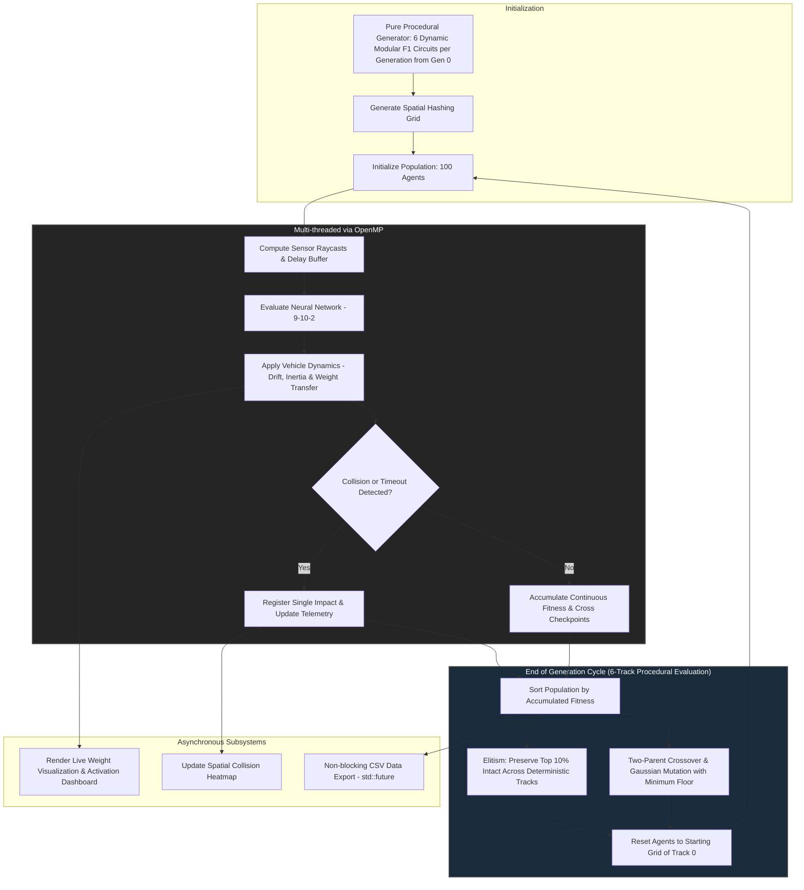

# NeuralRacer-CPP

A High-Performance 2D Autonomous Driving Simulation and Neuroevolution Engine in Modern C++17.

[](https://en.cppreference.com/w/cpp/17)
[](https://www.raylib.com/)
[](https://cmake.org/)
[](https://www.openmp.org/)
[](LICENSE)

---

## Autonomous Training in Action


*Autonomous agents learning to navigate procedural racetracks using raw proximity raycasts and velocity vectors. The telemetry dashboard on the bottom left monitors fitness curves, while the neural topology map on the bottom right visualizes active synaptic weights in real time.*

---

## Technical Highlights

NeuralRacer-CPP is a high-performance simulation engine designed to explore autonomous driving behaviors through neuroevolutionary algorithms. The core objective of the project is to simulate realistic physical vehicle dynamics and train autonomous agents to navigate complex, procedurally generated race tracks. 

To achieve maximum computational efficiency and real-time responsiveness, the entire system is built **completely from scratch** in Modern C++17 without relying on high-level machine learning frameworks or pre-existing physics engines.

*   **Spatial Partitioning:** Utilizes a custom **Spatial Hashing Grid** to reduce narrow-phase collision checks and sensor raycasting from $O(N)$ to $O(1)$, limiting OBB checks to immediate $3\times3$ neighboring cells and raycasts to local grid bounding boxes across the entire $2400 \times 1600\text{ px}$ world canvas.
*   **F1-Scale World Expansion & Dynamic 2D Camera:** Expands the simulation canvas to an expansive $2400 \times 1600\text{ px}$ arena ($6.4\times$ track area) supporting genuine Grand Prix aspect ratios (up to 3.5:1) and $600\text{--}900\text{ px}$ DRS straights. Decoupled world rendering features a Raylib `Camera2D` dynamic chase drone with spring-damper tracking (`CAM_FOLLOW_LEADER`), adaptive full-track overview (`CAM_OVERVIEW`), smooth mouse-wheel zooming, and a real-time tactical F1 Minimap HUD.
*   **Hardware Concurrency:** Exploits multi-core architectures by parallelizing the physics engine and neural network evaluations using native **OpenMP** multi-threading and C++17 vectorization across all CPU cores.
*   **Asynchronous Subsystems:** Implements non-blocking disk serialization (`std::async`/`std::future`) to isolate high-frequency hot paths from storage delays during generational checkpoints.
*   **Custom Neural Control:** Employs a custom 9-10-2 Feedforward Neural Network (FNN) and a Genetic Algorithm featuring dynamic Gaussian mutation decay with a sustained exploration floor, Time-to-Collision observation, and deterministic multi-circuit elitism, all written from first principles.

---

## Operational Simulation Modes

The engine provides three distinct simulation configurations to analyze agent behaviors and allow interactive testing:

| **1. Training Mode** | **2. Exhibition Mode** | **3. Test AI Mode** |
| :---: | :---: | :---: |
|  |  |  |
| *Neural network undergoing continuous training with live dashboard metrics and weight visualizations.* | *Manual player driving (blue car) competing head-to-head against the elite neural network brain (red car).* | *Observing the standalone driving strategy of the saved elite network navigate challenging curves.* |

---

## System Architecture

The following diagram illustrates the execution lifecycle, data pipelines, and concurrency models utilized by the simulator:



---

## Core Technical Features & Code Highlights

### 1. High-Concurrency Physics and Inference Loop
To simulate 100 agents concurrently under tight real-time constraints, the engine leverages multi-core processing through **OpenMP** dynamic work distribution. Inferences and kinematics are updated in parallel using a thread-safe implementation, with crash event telemetry isolated to single-trigger occurrences:

```cpp
// From src/Simulation.cpp
// Fully parallelized evaluation of the active population across all CPU threads
#pragma omp parallel for schedule(static)
for (int i = 0; i < (int)population.size(); i++) {
    Car& car = population[i];
    if (!car.isCrashed) {
        carsAlive++;
        
        // 1. Evaluate the custom neural network with 9-dimensional state space
        float inputAccelerate = 0.0f, inputTurn = 0.0f;
        car.Think(inputAccelerate, inputTurn);
        
        // 2. Perform narrow-phase physics and collision routines
        car.UpdatePhysics(inputAccelerate, inputTurn, spatialGrid, generationTimer, trackCheckpoints);
    }
}

// Single-trigger telemetry logging on the exact frame of impact
for (auto& car : population) {
    if (car.justCrashed) {
        Telemetry::RecordCrash(car.position);
        car.justCrashed = false;
    }
}
```

### 2. Spatial Grid Partitioning (Collision Optimization)
Instead of executing naive $O(N)$ collision tests against all boundary segments, the track is divided into a static $100\times100\text{px}$ spatial hashing grid. Narrow-phase OBB vehicle checks are restricted to an immediate $3\times3$ cell neighborhood, and sensor raycasts query only the specific axis-aligned grid bounding boxes of each ray:

```cpp
// From src/Car.cpp
// 1. Immediate 3x3 OBB Narrow-Phase Check
int myCellX = (int)std::floor(position.x / TrackManager::GRID_CELL_SIZE);
int myCellY = (int)std::floor(position.y / TrackManager::GRID_CELL_SIZE);

for (int gx = myCellX - 1; gx <= myCellX + 1 && !isCrashed; gx++) {
    for (int gy = myCellY - 1; gy <= myCellY + 1 && !isCrashed; gy++) {
        uint64_t key = TrackManager::GetGridKey(gx, gy);
        auto it = spatialGrid.find(key);
        if (it != spatialGrid.end()) {
            for (const auto& wallLine : it->second) {
                if (CheckSegmentIntersection(carCorners, wallLine)) {
                    isCrashed = true;
                    justCrashed = true;
                    break;
                }
            }
        }
    }
}

// 2. Localized Raycasting along the ray's bounding box
for (int i = 0; i < 5; i++) {
    int rMinX = (int)std::floor(std::min(position.x, rayEnd[i].x) / TrackManager::GRID_CELL_SIZE);
    int rMaxX = (int)std::floor(std::max(position.x, rayEnd[i].x) / TrackManager::GRID_CELL_SIZE);
    int rMinY = (int)std::floor(std::min(position.y, rayEnd[i].y) / TrackManager::GRID_CELL_SIZE);
    int rMaxY = (int)std::floor(std::max(position.y, rayEnd[i].y) / TrackManager::GRID_CELL_SIZE);
    // Scan only bounding grid cells
}
```

### 3. Custom Neural Network & Dynamic Neuroevolution
The behavioral engine models decision-making processes from first principles:
*   **9-10-2 FNN Topology:** Integrates 5 directional proximity inputs, 1 Time-to-Collision front delta (from an 8-tick circular delay line), longitudinal velocity, lateral slip velocity, and angular yaw rate. Processed through a 10-node hidden layer with hyperbolic tangent ($\tanh$) activation to yield symmetrical continuous controls.
*   **Two-Stage Decremental Mutation Schedule with Horizon Milestones:** Implements an adaptive genetic algorithm controlling both gene mutation probability and Gaussian perturbation step size across a calibrated multi-horizon schedule:
    *   *Stage 1 (Generations 0–200, Macro-Exploration & Procedural Plasticity):* Decays smoothly from $50\%$ down to $25\%$ (`Config::STAGE1_MUTATION_MIN = 25`), with $\sigma$ transitioning from $0.12$ to $0.08$. This guarantees ample synaptic plasticity during Curriculum Induction, Consolidation, and early Procedural generalization, touching exactly $25\%$ at generation 200 to prevent procedural paralysis.
    *   *Stage 2 (Generations 200–400, Fine Exploitation & Load Reduction):* Decays gently from $25\%$ down to an ultra-fine floor of $3\%$ (`Config::STAGE2_MUTATION_MIN = 3`), with $\sigma$ transitioning from $0.08$ to $0.035$. This progressively eliminates deleterious mutation load on competent reflex controllers (raising fleet survival rate beyond $90\%$) while maintaining subtle micro-tuning capabilities.
    *   *Stage 3 (Generations 400+, Sustained Micro-Exploitation Floor):* Parameters remain fixed indefinitely at $3\%$ rate and $\sigma = 0.035$.
    $$\text{Stage 1 }(g < 200):\quad \text{decay}_1(g) = \max\left(0, \frac{\frac{1.0}{1.0 + k_1 \cdot g} - \frac{1.0}{1.0 + k_1 \cdot 200}}{1.0 - \frac{1.0}{1.0 + k_1 \cdot 200}}\right),\quad \text{Rate} = 25 + \text{round}(25 \cdot \text{decay}_1)$$
    $$\text{Stage 2 }(200 \le g < 400):\quad \text{decay}_2(g) = \max\left(0, \frac{\frac{1.0}{1.0 + k_2 \cdot (g - 200)}}{1.0 - \frac{1.0}{1.0 + k_2 \cdot 200}}\right),\quad \text{Rate} = 3 + \text{round}(22 \cdot \text{decay}_2)$$
*   **Pure Procedural Multi-Circuit Architecture from Generation 0 (6 Grand Prix Circuits per Generation):** Eliminates static track memorization and distribution shift by evaluating the population exclusively on dynamic procedural tracks from the very first generation:
    *   *6 Consecutive Grand Prix Circuits per Generation:* Every generation dynamically synthesizes 6 unique, closed racetracks via $SE(2)$ modular tile coupling across the expansive $2400 \times 1600\text{ px}$ canvas.
    *   *Systematic Topological Coverage:* Tracks 0 through 4 systematically sample the 5 core F1 macro-skeletons (Monza high-speed corridor, Silverstone tri-sector flow, Interlagos amphitheater horseshoe, Suzuka rhythm S-curves, and Montreal power straights), while Track 5 is generated with unconstrained stochastic macro-topology.
    *   *Zero Spatial Overfitting:* Because every circuit is assembled in real-time from the 17-tile catalog with dynamic rotations, cars cannot memorize fixed coordinate waypoints or time-based turn triggers; they must develop generalized sensory-motor primitives (LIDAR ray balancing, TTC threshold braking, and slip angle management).
    *   *Optimal Computation-Generalization Pareto Frontier:* Delivers high variance reduction and zero-shot transfer capabilities without the exponential computational cost of 64–128 tracks, completing a full 6-track generational evaluation in $\sim 1\text{ second}$ in headless OpenMP mode.

### 4. Mathematical Formula 1 Grand Prix Procedural Architecture
Includes an enterprise-grade procedural generation framework producing authentic, flowing race circuits based on real-world Grand Prix layout archetypes:
*   **Six Grand Prix Archetypes:** Dynamically synthesizes circuits using 6 core morphological paradigms:
    *   *Archetype 0 (Out-and-Back Corridor):* Parallel DRS straights with dual terminal hairpins and chicane complexes (inspired by Monza, Gilles-Villeneuve, and Red Bull Ring).
    *   *Archetype 1 (Infield Loop Complex):* High-speed outer perimeter connected to a deep, technical internal hairpin loop (inspired by Bahrain/Sakhir, Shanghai, and Silverstone).
    *   *Archetype 2 (Triangular & Diagonal):* Massive diagonal acceleration run, peak chicane, descending sweeping esses, and return chicane (inspired by Spa-Francorchamps, Paul Ricard, and Jeddah).
    *   *Archetype 3 (Asymmetric L-Shape):* Orthogonal dual straights, technical mid-sector esses, and descending carousel (inspired by Suzuka, Catalunya, and Zandvoort).
    *   *Archetype 4 (Dual-Lobe Horseshoe & Omega Waist):* Upper and lower bowl complexes connected through a technical narrowing waist and climbing sweepers (inspired by Interlagos, Hungaroring, and Lusail).
    *   *Archetype 5 (Urban Street Grid):* High-speed urban boulevard leading to sharp 90-degree threshold-braking complexes, harbor chicanes, and stadium sections (inspired by Singapore Marina Bay, Baku, and Albert Park).
*   **FIA Proportional Scale Overhaul:** Re-calibrated track width to $35\text{ px}$ and vehicle dimensions to $17 \times 8\text{ px}$ (preserving the realistic $23\%$ car-to-track width ratio). This scale unlocks $3\times$ greater relative spatial canvas, enabling multi-lane overtakes, deep infield loops, and authentic racing lines without artificial boundary collisions.
*   **Curvature & Viewport Bounds:** Generates smooth Catmull-Rom centerlines with guaranteed non-intersecting geometries, counter-clockwise winding (Gauss Shoelace validation), and strict $80\text{ px}$ viewport margins with sub-millisecond generation speed ($<0.5\text{ ms}$).

### 5. Advanced Kinematics & Race Physics
The vehicle kinematics engine bypasses simplified movement models in favor of real-world race physics:
*   **Speed-Dependent Ackermann Steering & Angular Yaw Inertia:** Yaw rate is kinematically scaled to forward speed with low-pass angular inertia filtering ($\omega_t = 0.65\,\omega_{t-1} + 0.35\,\omega_{\text{target}}$). This physically grounds steering response, prevents zero-speed spinning, and completely eliminates unphysical 1-tick bang-bang steering oscillation exploits.
*   **Friction Circle & Kamm Traction Budgeting:** Evaluates restoring cornering grip against a physical adhesion limit ($F_{\text{max\_grip}} = \mu_{\text{tire}} \cdot M$) and couples lateral grip demand to longitudinal engine traction ($F_{x,\max} = \sqrt{\max(0, F_{\text{grip}}^2 - F_y^2)}$). Applying high lateral cornering demand restricts available forward acceleration.
*   **Realistic Induced Scrub Drag & Coulomb Rolling Resistance:** Implements constant rolling friction ($F_{\text{roll}} = -\mu_{\text{roll}} \cdot \text{sgn}(v)$) and amplified lateral scrub resistance ($K_{\text{scrub}} = 55.0$) plus steering deflection drag ($K_{\text{steer}} = 0.08$). Any lateral weaving or zig-zagging on straightaways incurs an immediate $\approx 28\%$ speed penalty, making straight-line driving strictly optimal.
*   **Dynamic Weight Transfer:** Acceleration shifts normal forces rearward, reducing steering capacity (understeer); braking transfers load forward, sharpening steering response.
*   **Aerodynamics:** Applies quadratic drag force and speed-scaled downforce to stabilize tire cornering capabilities.

### 6. Directional Checkpoints & Anti-Exploit Pipeline
To eradicate circular reward-hacking and endless idling loops:
*   **Dense Sequential Checkpoint Mesh:** Generates 16 to 32 evenly spaced checkpoints (~100-150 px apart) along the track centerline, eliminating long blind zones.
*   **Directional Vector Validation:** Verifies that both the vehicle's heading and velocity vector align positively with the track's tangent ($\vec{v} \cdot \vec{\tau}_{\text{track}} > 0$ and $\vec{h} \cdot \vec{\tau}_{\text{track}} > 0.2$), strictly rejecting backwards passes, spin-outs, or donut maneuvers.
*   **Strict Sector Timeout:** Calibrates the maximum allowed time between consecutive checkpoints (`Config::CAR_MAX_TIME_WITHOUT_CHECKPOINT = 320` ticks / ~5.3s at 60 FPS) to account for genuine F1 Grand Prix track dimensions and ~140 px checkpoint spacing, eliminating false-positive timeout culling while strictly extinguishing idle drifting, backwards driving, and donut-spinning exploitation.
*   **Continuous Multi-Lap Evaluation & High-Speed Fitness Incentives:** Agents run continuous sequential laps across the circuit for the full generational duration (`Config::MAX_GENERATION_TIME = 2000` ticks). To reward racing line optimization, aggressive cruising momentum, and fastest lap execution rather than meandering raw distance accumulation:
    *   *Base Milestone:* Grants $+1500$ points upon completing each lap.
    *   *Cruising Velocity Bonus:* Direct velocity reward scaled to $+1.5 \times \text{speed}$ per tick, actively rewarding full-throttle high-speed cruising and punishing over-braking.
    *   *Normalized Time-to-Complete Delta:* Dynamically benchmarks lap duration against track complexity ($T_{\text{budget}} = N_{\text{cp}} \times 32\text{ ticks}$), awarding $+8.0$ points per tick saved ($\Delta T = \max(0, T_{\text{budget}} - T_{\text{lap}})$).
    *   *Purple Sector Personal Best:* Awards an extra $+500$ milestone bonus whenever an agent sets or breaks its personal best lap time.
    *   *Balanced Distance Scaling:* Distance traveled coefficient modulated to $0.5$ to eliminate lateral wandering incentives while preserving smooth early learning gradients.

### 7. Longitudinal Telemetry & Scientific Dataset Pipeline (F1 / MoTeC Grade)
To support empirical machine learning research and automotive control analysis, the telemetry subsystem implements a dual-tier telemetry pipeline:

#### A. Generational Convergence Dataset (`data/telemetry_log.csv`)
Records a comprehensive 20-parameter dataset across generations:
*   **Macro Convergence Metrics:** `Generation`, `MaxFitness`, `MinFitness`, `AvgFitness`.
*   **Viability & Diversity Metrics:** `SurvivalRate`, `AvgLifeTime`, `WeightVariance` (synaptic diversity metric), `ActiveMutationRate`.
*   **Curriculum & Generalization Analytics:** `CurriculumPhase` (1, 2, or 3), `BenchmarkFitness` (fixed control track score), `ProceduralFitness` (zero-shot transfer performance on procedural circuits).
*   **Kinematic & Lap Quality:** `TotalLapsCompleted`, `TopSpeedAvg` (cruising speed in px/tick), `SteeringSmoothness` (control stability factor $[0.0 - 1.0]$), `BestLapTime` (fastest recorded lap in seconds).
*   **Advanced Vehicle Dynamics & XAI:** `KammUtilAvg` (friction circle utilization ratio $\eta \in [0.0 - 1.0+]$), `SlipAngleAvg` (chassis slip angle $\alpha$ in degrees), `ControlJerkAvg` (rate of acceleration change / actuation stability), `TrackWidthUtil` (track width exploitation ratio), `NeuralSaturation` (proportion of hidden neurons saturated $> 0.90$).

#### B. High-Frequency Time-Series Dataset (`data/telemetry_best_lap.csv`)
Records full-rate (60 Hz / tick-by-tick) physical and neurocognitive metrics for the fastest lap set by the population:
*   **Kinematics & Spatial State:** `tick`, `lap_tick`, `distance`, global coordinates (`x, y`), scalar `speed`.
*   **Chassis Dynamics & Tire Adhesion:** Longitudinal and lateral velocity (`v_long, v_lat`), yaw rate (`angular_vel`), biaxial accelerations (`long_accel, lat_accel`), Kamm friction circle utilization (`kamm_util`), and dynamic slip angle (`slip_angle`).
*   **Actuator Ergonomics & Control Smoothness:** Raw driver inputs (`throttle_input, steer_input`), biaxial jerk derivatives (`jerk_long, jerk_lat`).
*   **Racing Line Analysis:** Normalized track centerline offset (`track_offset`).
*   **Perception & Explainable Neuroevolution (XAI):** 5 LIDAR distance rays, alongside analytical Jacobian sensitivities computed via the backpropagation chain rule:
    *   $\frac{\partial \text{Steer}}{\partial \text{Lidar}_{\text{Front}}}$ (`sens_steer_front`)
    *   $\frac{\partial \text{Steer}}{\partial (\text{Lidar}_{\text{Left}} - \text{Lidar}_{\text{Right}})}$ (`sens_steer_lat`)

### 5. High-Entropy Procedural Track Synthesis Engine (Stochastic Macro-Graph)
To prevent neural networks from overfitting to fixed track layouts, the procedural generator uses a high-entropy macro-graph pipeline that generates dense, topologically rich circuits:
*   **Multi-Centric Macro-Graphs & 6 Canonical Archetypes:** Synthesizes randomized macro-skeletons featuring out-and-back corridors, asymmetric infield loops, triangular diagonals, L-shape carousels, dual-lobe horseshoes, and urban street grids.
*   **Combinatorial Motif Injection:** Analyzes long straightaways and stochastically injects technical chicanes, esses, or kinks with dynamic lateral displacement.
*   **Unconstrained 360° Affine Transformation:** Implements arbitrary planar rotation ($\phi \in [0, 2\pi)$), asymmetric scaling, and dynamic margin fitting, ensuring start straights and apexes can emerge at any angle.
*   **Clearance & Self-Intersection Watchdog:** Validates candidates by verifying zero self-intersections and enforcing a minimum $45\text{ px}$ clearance between non-adjacent centerline sections, eliminating bottlenecks while maintaining high variance ($CV_L \approx 19\%$, $CV_{W/H} \approx 23\%$).

### 6. Discrete Modular Track Synthesis Engine ($SE(2)$ Tile Coupling) & F1 Macro-Skeletons
In addition to continuous spline-based macro-graphs, the engine implements a discrete modular track builder inspired by modular slot-car and tile coupling architectures:
*   **Expanded Functional Tile Catalog (17 Distinct Primitives):** Assembles tracks from discrete pre-validated geometric primitives with analytic curvature bounds:
    *   *Straights:* Micro connector (`STR_50`), medium (`STR_90`), standard (`STR_150`), extended DRS straightaway (`STR_240`), and F1 Grand Prix blast straights (`STR_350`, `STR_500`).
    *   *High-Speed Sweepers & Kinks (30°):* Flat-out fast bends (`CRV_30_R260`) and mega sweepers ($R=350\text{ px}$) (`CRV_30_R350`).
    *   *High-Downforce Arcs (45°):* Fast sweeps ($R=160\text{ px}$) (`CRV_45_R160`).
    *   *Open V-Corners (60°):* Technical apex corners ($R=150\text{ px}$) (`CRV_60_R150`).
    *   *Standard Corners (90°):* Medium speed turns ($R=130\text{ px}$) (`CRV_90_R130`).
    *   *Progressive Double-Apex Carousels & Pouhon Sweeps:* Decreasing radius arcs (`CRV_DBL_APEX`) and Spa-Francorchamps style high-g double apexes ($R_1=240\text{ px} \to R_2=150\text{ px}$) (`CRV_POUHON_DBL`).
    *   *Heavy Hairpins (180°):* Hard-braking loops ($R=120\text{ px}$) (`HRP_180_R120`).
    *   *Chicanes:* Fluid lateral offsets (`CHK_S_L40`) and violent Bus-Stop chicanes (`CHK_BUS_STOP`).
    *   *Technical & Flowing Esses:* Double sinusoidal complexes (`ESS_SNAKE`) and Silverstone-style high-speed Maggotts-Becketts-Chapel complexes (`ESS_MAGGOTTS`).
*   **5 Authentic Formula 1 Macro-Skeletons across $2400 \times 1600\text{ px}$ Canvas:**
    1.  *Monza Cathedral of Speed:* High-speed elongated corridor (3.2:1 aspect ratio), Variante del Rettifilo, Curva Grande, Lesmo double apex, back straight DRS, Variante Ascari, and the sweeping Parabolica.
    2.  *Silverstone / Spa Ardennes Sector Flow:* Tri-sector undulating course balancing full-throttle sweeps with technical infield S-curves and heavy braking hairpins.
    3.  *Interlagos / Spielberg Horseshoe:* Technical amphitheater horseshoe with downhill Senna-S transitions, sweeping lakeside straights, and uphill Junção climbs.
    4.  *Suzuka / COTA Rhythm Flow:* Rhythm first sector featuring 4 linked flowing esses, Dunlop curve, 130R high-speed sweep, and Casio chicane.
    5.  *Albert Park / Montreal Island Hybrid:* Park-street hybrid with rapid curb transitions, long perimeter power straights, and final braking chicane.
*   **Physical Curvature Adhesion Floor ($R_{\min} \ge 68\text{ px}$):** Strictly validates post-scale curvature via numerical 3-point circumradius checks, preventing any sector from exceeding the physical lateral grip limit ($a_c \le \mu g \approx 0.28\text{ px/tick}^2$) at high cruising speeds.
*   **Curriculum Phase 3 Integration (Generation 50+):** When evolutionary training advances past generation 50 into Phase 3 (Continuous Generalization), all dynamic procedural curriculum tracks are exclusively synthesized by this expanded modular tile coupling engine across the full $2400 \times 1600$ arena, exposing agents to varied track segments with authentic curvature constraints.
*   **$C^1$ Hermite Elastic Bridge & SAT Clearance:** Solves periodic loop closure ($\sum \Delta\vec{r} = \vec{0}$) with zero heading error using cubic Hermite interpolation and a head/tail-aware spatial clearance filter, achieving a $100\%$ closure success rate.

---

## System Performance & Design Patterns

The engineering challenges resolved in the codebase are mapped below to show the specific design patterns and systems paradigms utilized:

| Engineering Challenge | Architectural Solution | System Outcome |
| :--- | :--- | :--- |
| **Low Latency Updates** | Minimizing heap allocations on runtime hot paths, adopting cache-friendly static structures, and strict RAII usage. | Eliminates garbage collection spikes, ensuring consistent frame pacing under heavy computational loads. |
| **Parallel CPU Execution** | OpenMP dynamic loop multi-threading and zero-allocation stack evaluation. | Maximizes multi-core occupancy, scaling raycasts and physical updates seamlessly across available CPU cores. |
| **Geometric Complexity** | Procedural F1 convex-hull synthesis, sector motifs, Catmull-Rom splines, oriented bounding boxes (OBB), and localized vector intersections. | Delivers robust spatial generation and pixel-perfect collision checks. |
| **Storage Bottlenecks** | Isolating persistent disk writing operations (JSON and CSV) to asynchronous `std::async` worker threads. | Prevents main-thread rendering hiccups when saving elite brains or generational logs. |

---

## Tech Stack & Dependencies

*   **Language Standard:** Modern C++ (C++17)
*   **Graphics & Input Polling:** [raylib](https://www.raylib.com/) (Used strictly for windowing, hardware-accelerated 2D rendering, and keyboard input polling)
*   **Task Concurrency & Parallelism:** OpenMP multi-threading and [Intel OneTBB (Threading Building Blocks)](https://oneapi-src.github.io/oneTBB/)
*   **Build Automation:** CMake 3.10+
*   **Data Serialization:** [nlohmann/json](https://github.com/nlohmann/json) (Header-only serialization for agents and tracks)

---

## Directory Structure

```
NeuralRacer-CPP/
├── CMakeLists.txt         # CMake build configuration
├── LICENSE                # MIT License
├── README.md              # Project documentation
├── ROADMAP.md             # Development status tracker
├── docs/                  # Media and instructional documentation
│   ├── INSTRUCTIONS.md    # Guide on capturing images/GIFs for the simulator
│   ├── Training.gif       # Principal animated training loop capture
│   ├── Training.png       # Training mode screenshot
│   ├── Exhibition.png     # Exhibition mode screenshot
│   └── TestAI.png         # Test AI mode screenshot
├── include/               # Header definitions
│   ├── Brain.h            # Neural network struct and inference functions
│   ├── Car.h              # Vehicle state, kinematics, and OBB structure
│   ├── Config.h           # Simulation parameters, 2400x1600 world canvas dimensions, physical constants, and GA variables
│   ├── Evolution.h        # Genetic operators, crossover, and serialization helpers
│   ├── ModularTrackGenerator.h # Discrete tile/segment coupling engine (17 primitives, 5 F1 macro-skeletons, pre-flight geometric watchdog)
│   ├── Simulation.h       # Main coordinator, dynamic 2D camera system, minimap HUD, and screen state machine
│   ├── Telemetry.h        # Metrics collector, live dashboard, and CSV logger
│   ├── TelemetrySample.h  # Time-series sample struct for 60 Hz high-frequency telemetry logging
│   ├── TrackGenerator.h   # High-entropy procedural engine (macro-graphs, motifs, 360° affine transforms)
│   ├── TrackManager.h     # Grid Hashing utilities and track I/O routines
│   └── json.hpp           # nlohmann JSON utility library
├── src/                   # Source implementations
│   ├── Car.cpp            # Vehicle physics, weight transfer, and OBB checks
│   ├── Evolution.cpp      # Genetic algorithm execution and genome loading
│   ├── Simulation.cpp     # Execution loops, window drawing, and input handling
│   ├── Telemetry.cpp      # GUI dashboard rendering and async file writers
│   ├── TrackManager.cpp   # Catmull-Rom math, grid insertion, and raycasts
│   └── main.cpp           # Program entry point and CLI parser
├── data/                  # Persistent data directory
│   ├── best.json          # Serialized genomes of elite agents
│   ├── telemetry_log.csv  # Generational fitness logs (20 metrics)
│   ├── telemetry_best_lap.csv # 60 Hz per-tick high-frequency lap telemetry (MoTeC/ATLAS grade)
│   └── tracks/            # JSON track files
└── lib/                   # Project dependencies (optional)
```

---

## Installation & Build Instructions

### Prerequisites

Ensure a C++17 compatible compiler (GCC 8+, Clang 7+, or MSVC 2019+) is installed alongside CMake, raylib development libraries, OpenMP, and Intel TBB headers.

#### Ubuntu / Debian Installation:
```bash
sudo apt update
sudo apt install build-essential cmake libraylib-dev libomp-dev libtbb-dev
```

### Compilation

```bash
# 1. Clone the repository
git clone https://github.com/jorgebd21/ML_Coches.git
cd ML_Coches

# 2. Setup build directory
mkdir build && cd build

# 3. Configure build environment
cmake ..

# 4. Compile binary target
cmake --build .

# 5. Run the application
./bin/app
```

---

## Execution Modes & Control Bindings

| Mode | Input Key | Functionality |
| :--- | :---: | :--- |
| **Training Mode** | `[ T ]` | Spawns a population of 100 agents to undergo continuous evolutionary training. Supports telemetry overlays and speed multipliers. |
| **Exhibition Mode** | `[ E ]` | Places the user in manual control of a vehicle (Arrows/WASD) to race directly against the best saved AI agent loaded from `data/best.json`. |
| **Test AI Mode** | `[ A ]` | Loads the top-performing brain from disk and renders its continuous, uninterrupted driving behavior. |
| **Generate Track** | `[ P ]` | Instantly generates a unique closed racing circuit using the 12-family discrete modular tile engine. |
| **Save Track** | `[ G ]` | Exports the active procedural track from the menu state to a JSON file in `data/tracks/`. |

### Runtime Camera & Simulation Interactions:

*   `[ SPACE ]`: Toggles execution speed between **Normal Mode (1x)** and **Accelerated Headless-Equivalent Mode (50x)** for rapid population training.
*   `[ V ]`: Toggles camera view mode between dynamic leader-follow mode (`CAM_FOLLOW_LEADER`) and full-circuit overview mode (`CAM_OVERVIEW`).
*   `Mouse Wheel`: Adjusts camera zoom smoothly between $0.20\times$ (macro circuit view) and $2.50\times$ (tight vehicle cockpit chase).
*   `Right-Click / Middle-Click Drag`: Engages manual panning across the $2400 \times 1600\text{ px}$ canvas (`CAM_MANUAL`).
*   `Tactical F1 Minimap HUD`: Rendered in the bottom-left corner with real-time car positions (gold leader, blue podium contenders, red field) and a yellow frustum outline showing the active camera viewport.
*   `[ C ]`: Toggles the rendering of checkpoints.
*   `[ H ]`: Toggles the rendering of the Telemetry Dashboard and Collision Heatmap overlays.
*   `[ M ]`: Terminates the current mode and returns to the Main Menu.

---

## Mathematical Formulations

### 1. Neural Forward Pass
For hidden layer node $i$, activation $h_i$ is computed from 9 normalized inputs $x_j$, synaptic weights $W_{ij}$, and node bias $b_i$:
$$h_i = \tanh\left( \sum_{j=1}^{9} (x_j \cdot W_{ij}) + b_i \right) \quad \text{for } i \in [1, 10]$$

Continuous output controls (throttle/steering) are subsequently computed as:
$$\text{Output}_k = \tanh\left( \sum_{i=1}^{10} (h_i \cdot W'_{ki}) + b'_k \right) \quad \text{for } k \in [1, 2]$$

### 2. Inertial Slip Angle & Velocity Decomposition
When the vehicle changes its heading to $\theta_{t} = \theta_{t-1} + \Delta\theta$, its conserved world velocity $\vec{v} = (v_x, v_y)$ is decomposed into the new chassis coordinate frame, naturally producing the lateral slip velocity:
$$v_{\text{long}} = v_x \cos(\theta_t) + v_y \sin(\theta_t)$$
$$v_{\text{lat}} = -v_x \sin(\theta_t) + v_y \cos(\theta_t)$$

### 3. Tire Cornering Scrub Drag & Aerodynamics
In addition to quadratic aerodynamic drag, turning the wheels or sliding sideways creates induced tire scrub resistance that decelerates forward speed:
$$F_{\text{drag}} = -v_{\text{long}} \cdot |v_{\text{long}}| \cdot C_d$$
$$F_{\text{scrub}} = -v_{\text{long}} \cdot |v_{\text{lat}}| \cdot K_{\text{scrub}}$$
$$F_{\text{total\_long}} = F_{\text{engine}} + F_{\text{drag}} + F_{\text{scrub}}$$

### 4. Dynamic Tire Grip Saturation & Restoring Force
Cornering grip scales dynamically with weight transfer. When the required lateral force exceeds the tire adhesion limit $F_{\text{max\_grip}}$, the tire breaks traction and enters dynamic drift:
$$F_{\text{max\_grip}} = \mu_{\text{tire}} \cdot M \cdot \left( 1.0 + a_{\text{long}} \cdot k_{\text{weight}} \right)$$
$$F_{\text{lateral}} = \begin{cases} \text{sgn}(-v_{\text{lat}}) \cdot F_{\text{max\_grip}} & \text{if } |v_{\text{lat}} \cdot C_{\alpha}| > F_{\text{max\_grip}} \text{ (Drift)} \\ -v_{\text{lat}} \cdot C_{\alpha} \cdot \text{tractionMultiplier} & \text{otherwise (Adhesion)} \end{cases}$$

### 5. Kinematic World Velocity Projection
Following force integration, updated local chassis velocities are projected back to global space:
$$v_x = v_{\text{long}} \cos(\theta_t) - v_{\text{lat}} \sin(\theta_t)$$
$$v_y = v_{\text{long}} \sin(\theta_t) + v_{\text{lat}} \cos(\theta_t)$$

---

## License

This software is licensed under the MIT License.
Raylib and nlohmann/json libraries are properties of their respective maintainers under the Zlib/libpng and MIT licenses, respectively.
