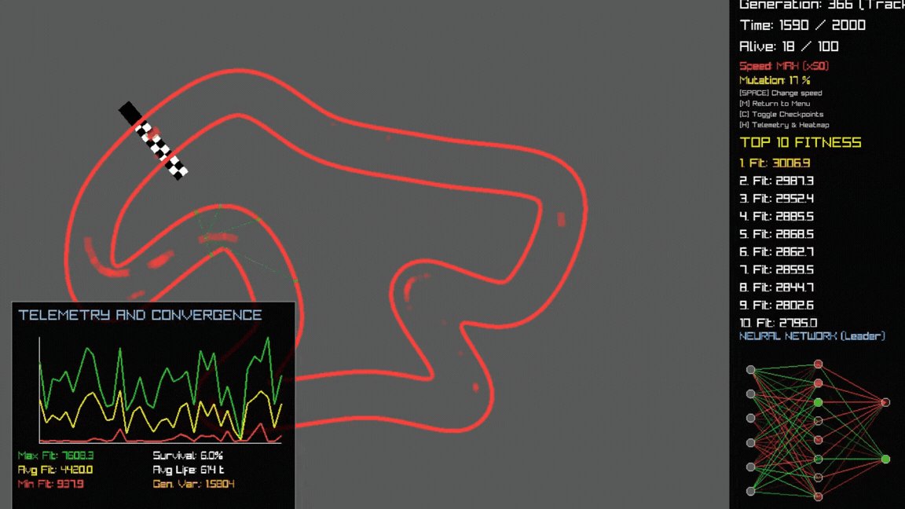
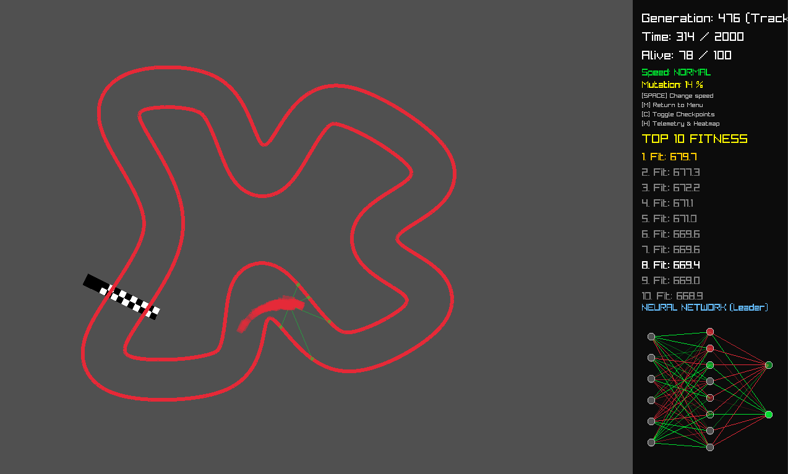
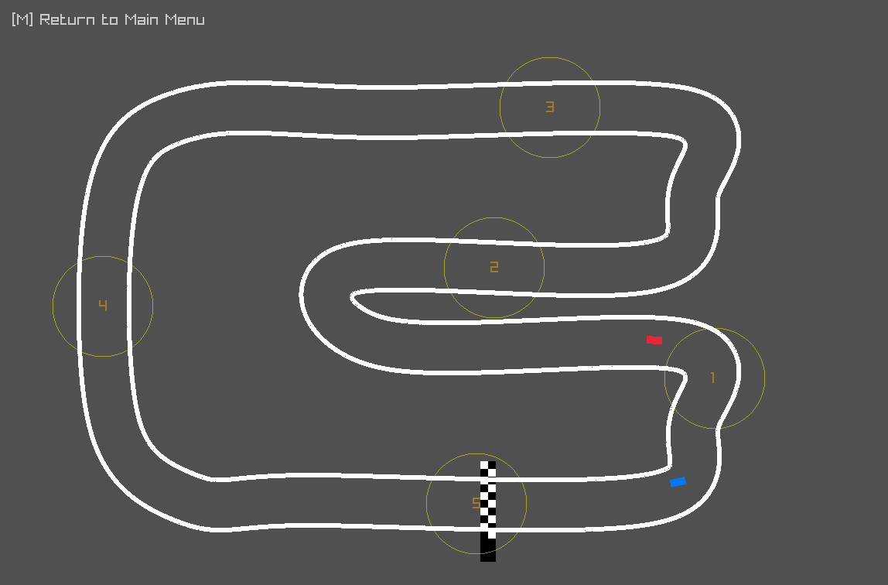
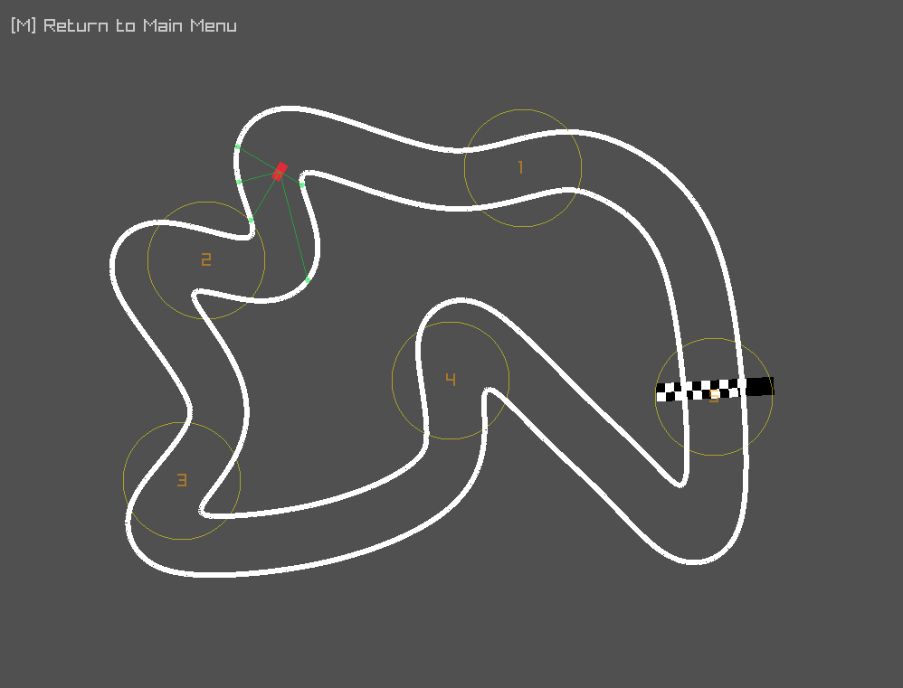
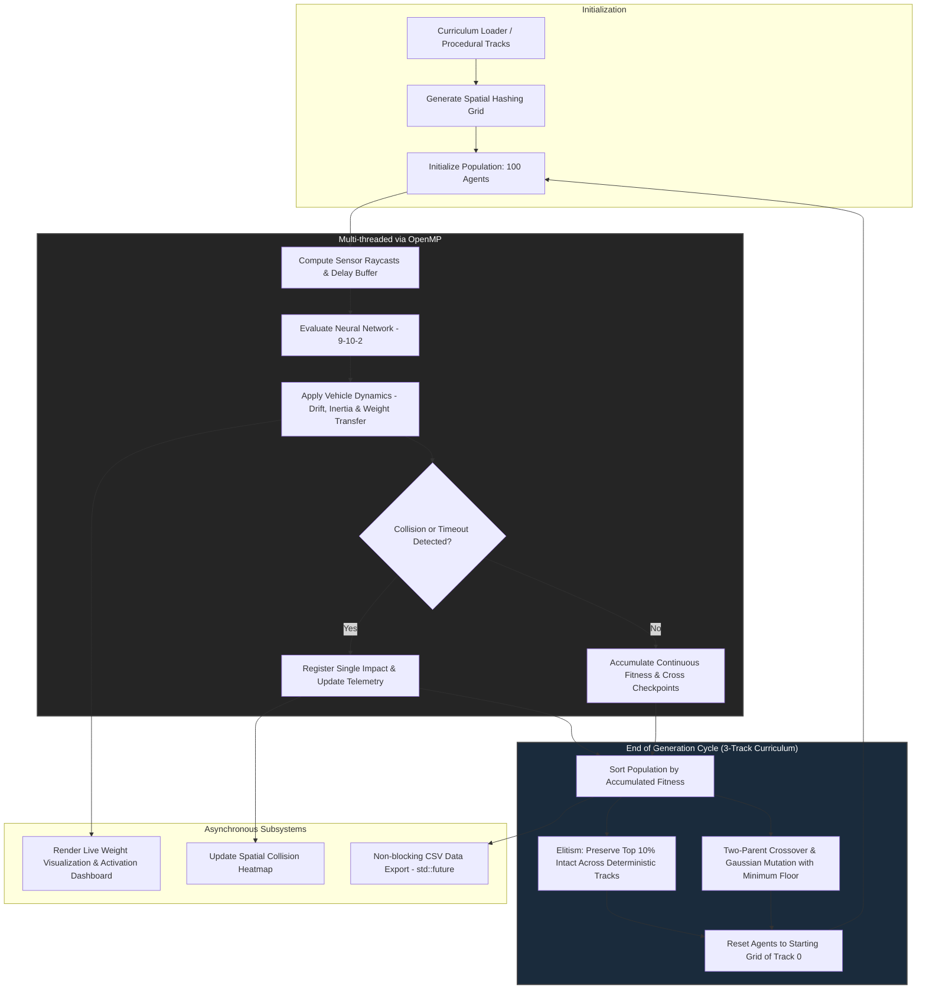

# NeuralRacer-CPP

A High-Performance 2D Autonomous Driving Simulation and Neuroevolution Engine in Modern C++17.

[](https://en.cppreference.com/w/cpp/17)
[](https://www.raylib.com/)
[](https://cmake.org/)
[](https://www.openmp.org/)
[](LICENSE)

---

## Autonomous Training in Action



*Autonomous agents learning to navigate procedural racetracks using raw proximity raycasts and velocity vectors. The telemetry dashboard on the bottom left monitors fitness curves, while the neural topology map on the bottom right visualizes active synaptic weights in real time.*

---

## Technical Highlights

NeuralRacer-CPP is a high-performance simulation engine designed to explore autonomous driving behaviors through neuroevolutionary algorithms. The core objective of the project is to simulate realistic physical vehicle dynamics and train autonomous agents to navigate complex, procedurally generated race tracks. 

To achieve maximum computational efficiency and real-time responsiveness, the entire system is built **completely from scratch** in Modern C++17 without relying on high-level machine learning frameworks or pre-existing physics engines.

*   **Spatial Partitioning:** Utilizes a custom **Spatial Hashing Grid** to reduce narrow-phase collision checks and sensor raycasting from $O(N)$ to $O(1)$, limiting OBB checks to immediate $3\times3$ neighboring cells and raycasts to local grid bounding boxes.
*   **Hardware Concurrency:** Exploits multi-core architectures by parallelizing the physics engine and neural network evaluations using native **OpenMP** multi-threading and C++17 vectorization across all CPU cores.
*   **Asynchronous Subsystems:** Implements non-blocking disk serialization (`std::async`/`std::future`) to isolate high-frequency hot paths from storage delays during generational checkpoints.
*   **Custom Neural Control:** Employs a custom 9-10-2 Feedforward Neural Network (FNN) and a Genetic Algorithm featuring dynamic Gaussian mutation decay with a sustained exploration floor, Time-to-Collision observation, and deterministic multi-circuit elitism, all written from first principles.

---

## Operational Simulation Modes

The engine provides three distinct simulation configurations to analyze agent behaviors and allow interactive testing:

| **1. Training Mode** | **2. Exhibition Mode** | **3. Test AI Mode** |
| :---: | :---: | :---: |
|  |  |  |
| *Neural network undergoing continuous training with live dashboard metrics and weight visualizations.* | *Manual player driving (blue car) competing head-to-head against the elite neural network brain (red car).* | *Observing the standalone driving strategy of the saved elite network navigate challenging curves.* |

---

## System Architecture

The following diagram illustrates the execution lifecycle, data pipelines, and concurrency models utilized by the simulator:



---

## Core Technical Features & Code Highlights

### 1. High-Concurrency Physics and Inference Loop
To simulate 100 agents concurrently under tight real-time constraints, the engine leverages multi-core processing through **OpenMP** dynamic work distribution. Inferences and kinematics are updated in parallel using a thread-safe implementation, with crash event telemetry isolated to single-trigger occurrences:

```cpp
// From src/Simulation.cpp
// Fully parallelized evaluation of the active population across all CPU threads
#pragma omp parallel for schedule(static)
for (int i = 0; i < (int)population.size(); i++) {
    Car& car = population[i];
    if (!car.isCrashed) {
        carsAlive++;
        
        // 1. Evaluate the custom neural network with 9-dimensional state space
        float inputAccelerate = 0.0f, inputTurn = 0.0f;
        car.Think(inputAccelerate, inputTurn);
        
        // 2. Perform narrow-phase physics and collision routines
        car.UpdatePhysics(inputAccelerate, inputTurn, spatialGrid, generationTimer, trackCheckpoints);
    }
}

// Single-trigger telemetry logging on the exact frame of impact
for (auto& car : population) {
    if (car.justCrashed) {
        Telemetry::RecordCrash(car.position);
        car.justCrashed = false;
    }
}
```

### 2. Spatial Grid Partitioning (Collision Optimization)
Instead of executing naive $O(N)$ collision tests against all boundary segments, the track is divided into a static $100\times100\text{px}$ spatial hashing grid. Narrow-phase OBB vehicle checks are restricted to an immediate $3\times3$ cell neighborhood, and sensor raycasts query only the specific axis-aligned grid bounding boxes of each ray:

```cpp
// From src/Car.cpp
// 1. Immediate 3x3 OBB Narrow-Phase Check
int myCellX = (int)std::floor(position.x / TrackManager::GRID_CELL_SIZE);
int myCellY = (int)std::floor(position.y / TrackManager::GRID_CELL_SIZE);

for (int gx = myCellX - 1; gx <= myCellX + 1 && !isCrashed; gx++) {
    for (int gy = myCellY - 1; gy <= myCellY + 1 && !isCrashed; gy++) {
        uint64_t key = TrackManager::GetGridKey(gx, gy);
        auto it = spatialGrid.find(key);
        if (it != spatialGrid.end()) {
            for (const auto& wallLine : it->second) {
                if (CheckSegmentIntersection(carCorners, wallLine)) {
                    isCrashed = true;
                    justCrashed = true;
                    break;
                }
            }
        }
    }
}

// 2. Localized Raycasting along the ray's bounding box
for (int i = 0; i < 5; i++) {
    int rMinX = (int)std::floor(std::min(position.x, rayEnd[i].x) / TrackManager::GRID_CELL_SIZE);
    int rMaxX = (int)std::floor(std::max(position.x, rayEnd[i].x) / TrackManager::GRID_CELL_SIZE);
    int rMinY = (int)std::floor(std::min(position.y, rayEnd[i].y) / TrackManager::GRID_CELL_SIZE);
    int rMaxY = (int)std::floor(std::max(position.y, rayEnd[i].y) / TrackManager::GRID_CELL_SIZE);
    // Scan only bounding grid cells
}
```

### 3. Custom Neural Network & Dynamic Neuroevolution
The behavioral engine models decision-making processes from first principles:
*   **9-10-2 FNN Topology:** Integrates 5 directional proximity inputs, 1 Time-to-Collision front delta (from an 8-tick circular delay line), longitudinal velocity, lateral slip velocity, and angular yaw rate. Processed through a 10-node hidden layer with hyperbolic tangent ($\tanh$) activation to yield symmetrical continuous controls.
*   **Hyperbolic Mutation Decay with Floor:** Implements an adaptive genetic algorithm. As generations advance, the mutation probability decays with an exploration safety floor (`Config::MIN_MUTATION = 15`) to maintain learning capacity for non-linear drifting maneuvers:
    $$\text{Mutation Rate} = \max\left(15, \left\lfloor \frac{\text{Max Mutation}}{1.0 + (\text{Drop Rate} \times \text{Generation})} \right\rfloor \right)$$
*   **Deterministic Multi-Track Curriculum:** Evaluates agents across a fixed progression of 3 tracks (`pista_facil`, `pista_medio`, `pista_dificil`), eliminating environmental noise to safeguard elitism and promote generalizable driving policies.

### 4. Mathematical Track Generation Pipeline
Includes a complete procedural generation framework to ensure agent robustness and avoid track-specific overfitting:
*   **Exclusion-Zone Node Distribution:** Distributes random control points maintaining strict Euclidean minimum distances.
*   **TSP Optimization (2-Opt):** Orders nodes utilizing a **Nearest Neighbor** traveling salesperson solver, then applies the **2-Opt** algorithm to eliminate intersecting lines.
*   **Spline Interpolation:** Applies **Catmull-Rom** splines to convert discrete routes into continuous curves.
*   **Winding-Order Validation:** Computes the signed **Gauss Area** of the track to guarantee a uniform counter-clockwise winding layout, preventing boundary collapse when generating inner and outer track walls.

### 5. Advanced Kinematics & Race Physics
The vehicle kinematics engine bypasses simplified movement models in favor of real-world race physics:
*   **Tire Slip and Lateral Drift:** Simulates lateral slip angle and cornering stiffness coefficients ($C_{\alpha}$). Exceeding traction thresholds induces realistic rotational slipping.
*   **Dynamic Weight Transfer:** Acceleration shifts normal forces rearward, reducing steering capacity (understeer); braking transfers load forward, sharpening steering response.
*   **Aerodynamics:** Applies quadratic drag force and speed-scaled downforce to stabilize tire cornering capabilities.

---

## System Performance & Design Patterns

The engineering challenges resolved in the codebase are mapped below to show the specific design patterns and systems paradigms utilized:

| Engineering Challenge | Architectural Solution | System Outcome |
| :--- | :--- | :--- |
| **Low Latency Updates** | Minimizing heap allocations on runtime hot paths, adopting cache-friendly static structures, and strict RAII usage. | Eliminates garbage collection spikes, ensuring consistent frame pacing under heavy computational loads. |
| **Parallel CPU Execution** | OpenMP dynamic loop multi-threading and zero-allocation stack evaluation. | Maximizes multi-core occupancy, scaling raycasts and physical updates seamlessly across available CPU cores. |
| **Geometric Complexity** | Procedural Catmull-Rom splines, TSP heuristics, oriented bounding boxes (OBB), and localized vector intersections. | Delivers robust spatial generation and pixel-perfect collision checks. |
| **Storage Bottlenecks** | Isolating persistent disk writing operations (JSON and CSV) to asynchronous `std::async` worker threads. | Prevents main-thread rendering hiccups when saving elite brains or generational logs. |

---

## Tech Stack & Dependencies

*   **Language Standard:** Modern C++ (C++17)
*   **Graphics & Input Polling:** [raylib](https://www.raylib.com/) (Used strictly for windowing, hardware-accelerated 2D rendering, and keyboard input polling)
*   **Task Concurrency & Parallelism:** OpenMP multi-threading and [Intel OneTBB (Threading Building Blocks)](https://oneapi-src.github.io/oneTBB/)
*   **Build Automation:** CMake 3.10+
*   **Data Serialization:** [nlohmann/json](https://github.com/nlohmann/json) (Header-only serialization for agents and tracks)

---

## Directory Structure

```
NeuralRacer-CPP/
├── CMakeLists.txt         # CMake build configuration
├── LICENSE                # MIT License
├── README.md              # Project documentation
├── ROADMAP.md             # Development status tracker
├── docs/                  # Media and instructional documentation
│   ├── INSTRUCTIONS.md    # Guide on capturing images/GIFs for the simulator
│   ├── Training.gif       # Principal animated training loop capture
│   ├── Training.png       # Training mode screenshot
│   ├── Exhibition.png     # Exhibition mode screenshot
│   └── TestAI.png         # Test AI mode screenshot
├── include/               # Header definitions
│   ├── Brain.h            # Neural network struct and inference functions
│   ├── Car.h              # Vehicle state, kinematics, and OBB structure
│   ├── Config.h           # Simulation parameters, physical constants, and GA variables
│   ├── Evolution.h        # Genetic operators, crossover, and serialization helpers
│   ├── Simulation.h       # Main program coordinator and screen state machine
│   ├── Telemetry.h        # Metrics collector, live dashboard, and CSV logger
│   ├── TrackGenerator.h   # Procedural logic (TSP, 2-Opt, splines)
│   ├── TrackManager.h     # Grid Hashing utilities and track I/O routines
│   └── json.hpp           # nlohmann JSON utility library
├── src/                   # Source implementations
│   ├── Car.cpp            # Vehicle physics, weight transfer, and OBB checks
│   ├── Evolution.cpp      # Genetic algorithm execution and genome loading
│   ├── Simulation.cpp     # Execution loops, window drawing, and input handling
│   ├── Telemetry.cpp      # GUI dashboard rendering and async file writers
│   ├── TrackManager.cpp   # Catmull-Rom math, grid insertion, and raycasts
│   └── main.cpp           # Program entry point and CLI parser
├── data/                  # Persistent data directory
│   ├── best.json          # Serialized genomes of elite agents
│   ├── telemetry_log.csv  # Generational fitness logs
│   └── tracks/            # JSON track files
└── lib/                   # Project dependencies (optional)
```

---

## Installation & Build Instructions

### Prerequisites

Ensure a C++17 compatible compiler (GCC 8+, Clang 7+, or MSVC 2019+) is installed alongside CMake, raylib development libraries, OpenMP, and Intel TBB headers.

#### Ubuntu / Debian Installation:
```bash
sudo apt update
sudo apt install build-essential cmake libraylib-dev libomp-dev libtbb-dev
```

### Compilation

```bash
# 1. Clone the repository
git clone https://github.com/jorgebd21/ML_Coches.git
cd ML_Coches

# 2. Setup build directory
mkdir build && cd build

# 3. Configure build environment
cmake ..

# 4. Compile binary target
cmake --build .

# 5. Run the application
./bin/app
```

---

## Execution Modes & Control Bindings

| Mode | Input Key | Functionality |
| :--- | :---: | :--- |
| **Training Mode** | `[ T ]` | Spawns a population of 100 agents to undergo continuous evolutionary training. Supports telemetry overlays and speed multipliers. |
| **Exhibition Mode** | `[ E ]` | Places the user in manual control of a vehicle (Arrows/WASD) to race directly against the best saved AI agent loaded from `data/best.json`. |
| **Test AI Mode** | `[ A ]` | Loads the top-performing brain from disk and renders its continuous, uninterrupted driving behavior. |
| **Generate Track** | `[ P ]` | Instantly generates a unique procedural racing circuit using optimization heuristics. |
| **Save Track** | `[ G ]` | Exports the active procedural track from the menu state to a JSON file in `data/tracks/`. |

### Runtime Training Interactions:

*   `[ SPACE ]`: Toggles execution speed between **Normal Mode (1x)** and **Accelerated Headless-Equivalent Mode (50x)** for rapid population training.
*   `[ C ]`: Toggles the rendering of checkpoints.
*   `[ H ]`: Toggles the rendering of the Telemetry Dashboard and Collision Heatmap overlays.
*   `[ M ]`: Terminates the current mode and returns to the Main Menu.

---

## Mathematical Formulations

### 1. Neural Forward Pass
For hidden layer node $i$, activation $h_i$ is computed from 9 normalized inputs $x_j$, synaptic weights $W_{ij}$, and node bias $b_i$:
$$h_i = \tanh\left( \sum_{j=1}^{9} (x_j \cdot W_{ij}) + b_i \right) \quad \text{for } i \in [1, 10]$$

Continuous output controls (throttle/steering) are subsequently computed as:
$$\text{Output}_k = \tanh\left( \sum_{i=1}^{10} (h_i \cdot W'_{ki}) + b'_k \right) \quad \text{for } k \in [1, 2]$$

### 2. Kinematic Velocity Projection
World velocity vector $\vec{v} = (v_x, v_y)$ is transformed from local body-frame longitudinal ($v_{\text{long}}$) and lateral ($v_{\text{lat}}$) velocities using vehicle heading $\theta$:
$$v_x = v_{\text{long}} \cos(\theta) - v_{\text{lat}} \sin(\theta)$$
$$v_y = v_{\text{long}} \sin(\theta) + v_{\text{lat}} \cos(\theta)$$

### 3. Physical Weight-Transfer & Restoring Lateral Slip Force
Longitudinal acceleration $a_{\text{long}}$ dynamically scales the tire normal force distribution, shifting front and rear cornering grip. Symmetrical restoring slip forces are evaluated by:
$$F_{\text{lateral}} = -v_{\text{lateral}} \cdot \left( C_{\alpha} \cdot \left( 1.0 + a_{\text{long}} \cdot k_{\text{weight}} \right) \right)$$
$$a_{\text{lateral}} = \frac{F_{\text{lateral}}}{M}$$
Where $C_{\alpha}$ is the tire cornering stiffness, $k_{\text{weight}}$ is the weight transfer factor, and $M$ is the vehicle mass. If $|a_{\text{lateral}}| > |v_{\text{lateral}}|$, $v_{\text{lateral}}$ is clamped directly to $0.0$ to eliminate residual sliding oscillation.

### 4. Aerodynamics Drag
Air resistance is calculated quadratically based on the current longitudinal speed:
$$F_{\text{drag}} = -v_{\text{long}} \cdot |v_{\text{long}}| \cdot C_d$$

---

## License

This software is licensed under the MIT License.
Raylib and nlohmann/json libraries are properties of their respective maintainers under the Zlib/libpng and MIT licenses, respectively.
